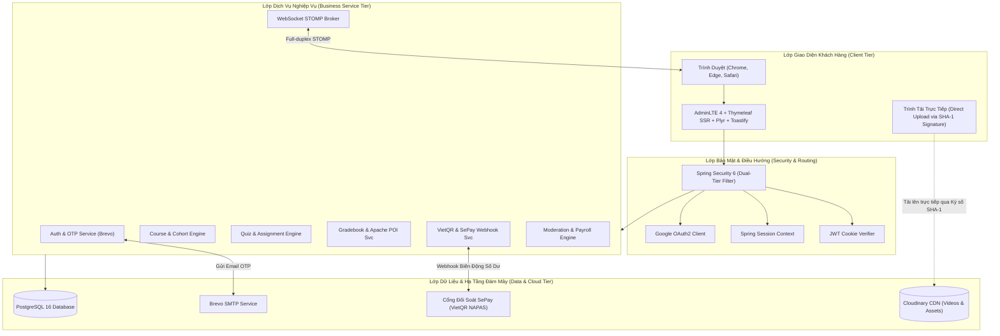

# 🎓 UTELearn - Nền Tảng Học Trực Tuyến Theo Đợt & Quản Trị Giáo Dục Doanh Nghiệp

> **Đồ án cuối kỳ môn Lập trình Web** - Trường Đại học Sư phạm Kỹ thuật TP.HCM (HCMUTE)  
> Hệ thống giáo dục trực tuyến thế hệ mới kết hợp mô hình đào tạo theo đợt học (**Cohort-Based Learning**), tích hợp đối soát thanh toán tự động qua **VietQR & SePay Webhook**, bảo mật đa tầng, truyền thông thời gian thực **WebSocket**, kiểm duyệt nội dung đa cấp, sổ điểm điện tử **Apache POI** và hệ thống chấm công - tính lương chuẩn doanh nghiệp.

[](https://www.oracle.com/java/)
[](https://spring.io/projects/spring-boot)
[](https://www.postgresql.org/)
[](https://adminlte.io/)
[](https://www.docker.com/)
[](https://github.com/features/actions)
[](LICENSE)

---

## 👥 Thành Viên Thực Hiện & Phân Chia Trách Nhiệm

Dự án được xây dựng dựa trên nguyên tắc **phân quyền chuyên biệt, chuẩn hóa luồng nghiệp vụ và minh bạch 100% theo lịch sử Git Commits**:

| Thành viên | Mã số Sinh viên (MSSV) | Vai trò chính | Trọng tâm đóng góp |
| :--- | :--- | :--- | :--- |
| **Nguyễn Thành Tiến** | **24110352** | Trưởng nhóm / Full-stack Developer | Kiến trúc Hạ tầng, CI/CD, Bảo mật Kép, Cổng VietQR SePay, Realtime WebSocket, Tải lên Ký số Cloudinary, AdminLTE 4 & UI/UX |
| **Nguyễn Đặng Cao Tường** | **24110375** | Thành viên / Full-stack Developer | Khảo thí Trắc nghiệm Quiz & Bài tập, Sổ điểm Apache POI, Chứng chỉ Số, Kiểm duyệt Khóa học & Chấm công - Lương cơ bản |

---

## 📊 Bảng Phân Chia Nghiệp Vụ Bám Sát 100% Lịch Sử Git Commits

Bảng đối chiếu chi tiết giữa trách nhiệm đảm nhiệm và các tính năng đã được hiện thực hóa qua lịch sử commit trên hệ thống:

| Thành viên | Luồng Nghiệp Vụ | Chi Tiết Tính Năng Đã Triển Khai (Dựa Trên Commit) |
| :--- | :--- | :--- |
| **Nguyễn Thành Tiến**<br>*(MSSV: 24110352)* | **1. Kiến Trúc Hạ Tầng, Core & CI/CD** | - Khởi tạo kiến trúc phân tầng Spring Boot 4.1.x, Java 21 LTS, kết nối PostgreSQL 16 đám mây Aiven.<br>- Cấu hình Dockerfile đa tầng và Docker Compose (môi trường dev & production).<br>- Xây dựng pipeline GitHub Actions 3 giai đoạn tự động kiểm thử, phân tích mã nguồn và triển khai Render PaaS.<br>- Cơ chế tự động duy trì máy chủ đám mây (Self Keep-Alive Service) ngăn chặn hiện tượng Cold-Start. |
| | **2. Bảo Mật Kép & Phân Quyền RBAC Động** | - Cơ chế xác thực kép Dual-Tier: Stateless JWT qua HttpOnly Secure Cookie kết hợp Stateful Spring Session.<br>- Đăng ký tài khoản xác thực mã OTP qua Email với dịch vụ Brevo SMTP API.<br>- Đăng nhập một chạm Google OAuth2 OIDC; chính sách chống sửa mật khẩu tài khoản Google.<br>- Phân quyền động 1-to-1 (RBAC Dynamic Permissions), cơ chế Zero-Escalation chặn nâng quyền Admin trái phép.<br>- Tính năng khóa tài khoản tức thời (Instant Session Kick-out upon Account Lock) thu hồi phiên ngay lập tức. |
| | **3. Tài Chính, Ví Điện Tử & Thanh Toán VietQR** | - Tích hợp cổng VietQR sinh mã QR động chuẩn NAPAS 24/7 theo từng mã đơn hàng.<br>- Xây dựng Webhook SePay đối soát biến động số dư ngân hàng tự động, xử lý Idempotency và khóa giao dịch.<br>- Vận hành hệ thống Ví điện tử UTELearn, Giỏ hàng đa sản phẩm (Cart), Quầy thu ngân đa kênh (Multi-item POS).<br>- Động cơ khuyến mãi & Voucher giảm giá (Discount Engine) tự động khấu trừ theo giá trị hoặc phần trăm. |
| | **4. Truyền Thông Realtime & Thông Báo Đẩy** | - Xây dựng phòng chat trực tiếp đợt học (Cohort Chat) trên nền tảng WebSocket STOMP Broker & SockJS.<br>- Trung tâm thảo luận giảng viên (Instructor Discussion Hub) với thuật toán tự động đôn đợt học có tin nhắn mới lên đầu thời gian thực.<br>- Tính năng kiểm duyệt trao đổi: Cho phép người dùng thu hồi tin nhắn và giảng viên xóa tin nhắn vi phạm.<br>- Hệ thống thông báo đẩy toàn cục theo người dùng (`/topic/notifications/{userId}`). |
| | **5. Thư Viện Tài Nguyên Ký Số Cloudinary** | - Cơ chế ký số SHA-1 upload trực tiếp từ trình duyệt lên Cloudinary CDN (Direct Signed Upload), giải phóng hoàn toàn băng thông máy chủ.<br>- Hỗ trợ tải lên trực tiếp và preview avatar, thumbnail khóa học, tài liệu bài giảng và video. |
| | **6. Tối Ưu Hóa Giao Diện Doanh Nghiệp & Tìm Kiếm** | - Tích hợp hệ thống giao diện AdminLTE 4 chuẩn UX/UI doanh nghiệp cho toàn bộ phân hệ quản trị.<br>- Chuẩn hóa dropdown thao tác tập trung `⚙ Thao tác ▾` cho tất cả các bảng dữ liệu.<br>- Tìm kiếm không dấu (Diacritics-insensitive Search) tích hợp hàm PostgreSQL `unaccent` trong HQL.<br>- Kỹ thuật Debounce Search giảm tải truy vấn và Universal Pagination kết hợp Page Size Selector.<br>- Đồng bộ hệ thống thông báo trạng thái Toastify tương tác AJAX mượt mà. |
| | **7. Chấm Công & Tính Lương Nâng Cao** | - Tối ưu hóa giao diện điểm danh ca trực thành nút thao tác đơn (Single-action Attendance).<br>- Bổ sung công thức tính lương làm thêm giờ (Overtime - OT Payroll Rate) vào bảng lương kiểm duyệt. |
| **Nguyễn Đặng Cao Tường**<br>*(MSSV: 24110375)* | **1. Quản Trị Khóa Học & Đợt Học (Course & Cohort)** | - Xây dựng quy trình CRUD Khóa học và vòng đời phê duyệt đa trạng thái (`DRAFT` ➔ `SUBMITTED` ➔ `APPROVED` ➔ `PUBLISHED`).<br>- Hiện thực hóa mô hình đợt học (Cohort-Based Learning): Quản lý sĩ số, lịch trình và thời gian biểu.<br>- Thiết kế giao diện giáo trình Moodle-style curriculum hỗ trợ chỉnh sửa inline.<br>- Bộ lọc danh mục động (Dynamic Filtering) và cơ chế bán gộp khóa học (Upsell Full Course vs Individual Cohort). |
| | **2. Không Gian Học Tập & Trình Xem Đa Phương Tiện** | - Tích hợp trình phát video responsive Plyr Player tối ưu trải nghiệm học trực tuyến.<br>- Trình xem tài liệu trực tiếp trên trình duyệt (In-browser Document Viewer) cho PDF và bài đọc.<br>- Tự động trích xuất và tính toán thời lượng video bài giảng khi tải lên.<br>- Xây dựng các loại hoạt động học tập (Video activity, Lecture, Document attachment). |
| | **3. Khảo Thí & Đánh Giá Năng Lực (Quiz & Assignment)** | - Ngân hàng câu hỏi trắc nghiệm, tạo đề thi ngẫu nhiên và cấu hình hạn nộp (Deadline Scheduler).<br>- Giao diện làm bài thi trắc nghiệm đổi mới với cơ chế tự động lưu bài làm trong khi thi (Autosave Testing Process).<br>- Chấm điểm trắc nghiệm tự động ngay khi học viên nộp bài.<br>- Phân hệ nộp bài tập tự luận (Assignment Submission) và chuyên trang chấm điểm riêng biệt kèm rubric đánh giá. |
| | **4. Sổ Điểm Điện Tử & Xử Lý Excel (Apache POI)** | - Tự động tổng hợp điểm quá trình từ chuyên cần, bài kiểm tra trắc nghiệm và bài tập tự luận.<br>- Đồng bộ Sổ điểm Đợt học (Cohort Gradebook) và Sổ điểm Toàn khóa (Course Gradebook).<br>- Tích hợp thư viện Apache POI xuất bảng điểm chuẩn định dạng `.xlsx` và nhập điểm hàng loạt với cơ chế bắt lỗi dữ liệu từng ô. |
| | **5. Chứng Chỉ Số & Đánh Giá Khóa Học** | - Động cơ tự động thẩm định điều kiện hoàn thành khóa học và cấp Chứng chỉ số (Certificate Issuance).<br>- Trang tra cứu và xác thực chứng chỉ công khai toàn cầu qua mã định danh (`/certificates/verify?code=...`).<br>- Hệ thống đánh giá sao (Star Rating) và nhận xét khóa học/đợt học kèm bộ lọc theo mốc thời gian. |
| | **6. Quy Trình Kiểm Duyệt Nội Dung Đa Cấp** | - Xây dựng luồng tương tác kiểm duyệt bài giảng giữa Giảng viên và Kiểm duyệt viên (Moderator).<br>- Thẩm định tài liệu, ghi nhận phản hồi duyệt/từ chối/yêu cầu sửa đổi và leo thang Quản trị viên.<br>- Tách biệt quyền chỉnh sửa `canEdit` và quyền thẩm định `hasAccessRole`.<br>- Tự động gửi thông báo thời gian thực giữa Moderator và Instructor xuyên suốt quá trình kiểm duyệt. |
| | **7. Chấm Công & Bảng Lương Cơ Bản** | - Giao diện quản lý ca trực, Check-in / Check-out cho đội ngũ kiểm duyệt viên.<br>- Công thức tính toán bảng lương: Chia sẻ doanh thu cho Giảng viên; tính lương theo ca trực, số phút làm việc cho Kiểm duyệt viên. |

---

## 🌟 Công Nghệ Nổi Bật & Kỹ Thuật Mới Chuẩn Doanh Nghiệp

### 1. Kiến Trúc Lõi Hiện Đại (Java 21 LTS & Spring Boot 4.1.x)
- Ứng dụng sức mạnh của **Java 21 LTS** với bộ xử lý ảo (Virtual Threads ready), Pattern Matching và Record classes.
- Khung ứng dụng **Spring Boot 4.1.x** tối ưu hóa bộ nhớ khởi động, tích hợp Spring Data JPA, Hibernate 6 và Spring Validation.

### 2. Bảo Mật Hai Lớp (Dual-Tier Auth) & Thu Hồi Phiên Tức Thời (Realtime Session Revocation)
- **Kiến trúc xác thực lai (Hybrid Auth)**: Sử dụng JWT lưu trong **HttpOnly Secure Cookie** chống tấn công XSS, đồng thời duy trì **Spring Security Session** tại máy chủ để kiểm soát trạng thái đăng nhập.
- **Instant Kick-out on Account Lock**: Khi Admin thực hiện khóa tài khoản vi phạm, hệ thống kích hoạt cơ chế dọn dẹp bảo mật tức thì (`SecurityContext` & Session invalidation), đẩy người dùng ra khỏi hệ thống ngay lập tức mà không cần đợi token hết hạn.
- **Xác thực OTP qua Brevo SMTP**: Luồng đăng ký tài khoản và quên mật khẩu gửi mã số OTP 6 chữ số qua email an toàn, chống đăng ký tài khoản ảo.

### 3. Cổng Thanh Toán VietQR NAPAS 24/7 & Đối Soát SePay Tự Động
- **Sinh mã VietQR động**: Tự động mã hóa thông tin tài khoản, ngân hàng thụ hưởng, số tiền và mã hóa đơn vào chuỗi VietQR chuẩn NAPAS.
- **SePay Webhook Auto-Reconciliation**: Nhận thông báo biến động số dư ngân hàng qua Webhook với cơ chế chống xử lý lặp lại (**Idempotency Guard**), tự động nạp tiền vào ví hoặc hoàn tất đơn hàng trong vòng 1-2 giây.

### 4. Giao Tiếp Thời Gian Thực (Full-Duplex WebSocket STOMP)
- Tích hợp **STOMP Protocol** chạy trên nền **SockJS WebSocket** hỗ trợ chuyển đổi giao thức linh hoạt (fallback to HTTP streaming/polling khi mạng hạn chế).
- **Cohort Chat Room**: Mỗi đợt học có một phòng trao đổi độc lập với cơ chế tự động xếp thứ tự ưu tiên (Auto-bump) cho giảng viên và kiểm duyệt viên.

### 5. Tải Lên Ký Số Trực Tiếp Lên Đám Mây (Cloudinary Direct Signed Uploads)
- Máy chủ Spring Boot chỉ đóng vai trò sinh chữ ký xác thực SHA-1 (`timestamp`, `public_id`, `api_secret`).
- Trình duyệt phía người dùng tải trực tiếp tệp tin video/ảnh lên máy chủ CDN Cloudinary, giúp máy chủ ứng dụng **giảm tải 100% băng thông và bộ nhớ RAM** xử lý file nhị phân lớn.

### 6. Xử Lý Bảng Tính Doanh Nghiệp Hiệu Năng Cao (Apache POI 5.4.0)
- Động cơ xuất/nhập Sổ điểm hỗ trợ tệp tin Excel dung lượng lớn, định dạng chuẩn quốc tế `.xlsx`.
- Cơ chế kiểm tra tính hợp lệ dữ liệu (Data Validation) từng ô: Kiểm tra định dạng điểm (0-10), kiểm tra sự tồn tại của học viên trong đợt học và tự động rollback khi phát hiện dòng lỗi.

### 7. Tối Ưu Tìm Kiếm Không Dấu (PostgreSQL `unaccent` & Debounce Search)
- Tích hợp hàm `unaccent()` của PostgreSQL vào các câu truy vấn HQL, cho phép tìm kiếm khóa học, giảng viên, đợt học bằng tiếng Việt có dấu hoặc không dấu với tốc độ tương đương nhau.
- Phía Client sử dụng kỹ thuật **Debounce 300ms** giảm tải số lượng request gửi lên server trong khi người dùng gõ từ khóa.

### 8. Giao Diện Doanh Nghiệp AdminLTE 4 & Trải Nghiệm Tương Tác AJAX Toastify
- Tích hợp thiết kế tiêu chuẩn **AdminLTE 4** hiện đại, đồng bộ màu sắc và hệ thống class cấu trúc layout chuẩn (`app-wrapper`, `app-sidebar`, `app-main`).
- Mọi tương tác thêm vào giỏ, cập nhật quyền, duyệt đơn hàng đều được xử lý mượt mà qua AJAX kết hợp thư viện thông báo nổi **Toastify**.

### 9. Đường Ống Tích Hợp & Triển Khai Tự Động (Multi-Stage CI/CD & Quality Gate)
- Pipeline GitHub Actions 3 giai đoạn: Kiểm tra chất lượng mã (Lint/Pre-commit) ➔ Kiểm thử tự động (Unit/Integration Test với JUnit 5 & Mockito) ➔ Đóng gói Docker & Triển khai liên tục lên Render.
- Tự động duy trì trạng thái máy chủ (Keep-Alive Service) gửi heartbeat định kỳ giúp hệ thống sẵn sàng phản hồi ngay lập tức.

---

## 🏛️ Sơ Đồ Kiến Trúc Hệ Thống (Architecture Diagrams)



---

## 🛠️ Yêu Cầu Môi Trường (Prerequisites)

* **Java Development Kit (JDK)**: Phiên bản 21 LTS trở lên.
* **Apache Maven**: Phiên bản 3.9+ (hoặc dùng `mvnw` đi kèm dự án).
* **Cơ sở dữ liệu**: PostgreSQL 15+ (Local hoặc Docker Container).
* **Docker & Docker Compose** (Tùy chọn nếu muốn chạy môi trường đóng gói).
* **Trình duyệt**: Hỗ trợ chuẩn HTML5 và WebSocket (Chrome, Edge, Firefox).

---

## 🚀 Hướng Dẫn Cài Đặt & Khởi Chạy

### Cách 1: Khởi chạy trực tiếp bằng Maven (Khuyến nghị cho Phát triển)

#### Bước 1: Khởi tạo cơ sở dữ liệu PostgreSQL
Mở pgAdmin hoặc công cụ dòng lệnh psql và tạo cơ sở dữ liệu:
```sql
CREATE DATABASE utelearn_db;
```

#### Bước 2: Cấu hình biến môi trường
Thiết lập các biến môi trường kết nối trong terminal (hoặc chỉnh sửa trực tiếp `src/main/resources/application.yml`):

*Trên Windows PowerShell:*
```powershell
$env:SPRING_DATASOURCE_URL="jdbc:postgresql://localhost:5432/utelearn_db"
$env:SPRING_DATASOURCE_USERNAME="postgres"
$env:SPRING_DATASOURCE_PASSWORD="your_postgres_password"
$env:DEFAULT_SEED_PASSWORD="Abc@1234"
```

*(Lưu ý: Nếu không cấu hình các dịch vụ bên ngoài như SePay, Cloudinary hoặc Google OAuth2, hệ thống sẽ tự động kích hoạt chế độ Giả lập / Demo an toàn).*

#### Bước 3: Biên dịch và chạy ứng dụng
```bash
# Biên dịch mã nguồn
mvn clean compile

# Khởi chạy máy chủ Spring Boot
mvn spring-boot:run
```

Sau khi màn hình hiển thị `Started UtelearnApplication`, truy cập hệ thống tại: **`http://localhost:8080`**

---

### Cách 2: Khởi chạy trọn gói bằng Docker Compose

Dự án đã tích hợp sẵn kịch bản Docker Compose khởi chạy đồng thời cả PostgreSQL và ứng dụng Spring Boot:

```bash
# Khởi động toàn bộ dịch vụ ở chế độ chạy ngầm
docker compose up -d --build
```

Để dừng toàn bộ dịch vụ:
```bash
docker compose down
```

---

## 🔑 Tài Khoản Trải Nghiệm Mặc Định (Seed Users)

Hệ thống được tích hợp bộ khởi tạo dữ liệu mẫu tự động (`DataSeeder`). Khi ứng dụng khởi động lần đầu, các tài khoản đại diện cho từng vai trò nghiệp vụ sẽ tự động được tạo sẵn.

> 🔒 Mật khẩu mặc định dùng chung cho tất cả các tài khoản là: **`Abc@1234`**

| Vai trò (Role) | Email đăng nhập | Quyền hạn và phạm vi thao tác |
| :--- | :--- | :--- |
| **Quản trị viên (Admin)** | `admin@utelearn.edu.vn` | Toàn quyền quản trị hệ thống, quản lý người dùng, phân quyền động, duyệt khóa học cấp cao, quản lý đơn hàng, danh mục, bảng lương. |
| **Tài chính (Finance)** | `finance@utelearn.edu.vn` | Quản lý hóa đơn đơn hàng, phê duyệt giao dịch, theo dõi đối soát SePay, xem báo cáo doanh thu và bảng lương thù lao. |
| **Giảng viên (Instructor)** | `instructor@utelearn.edu.vn` | Soạn thảo khóa học, mở đợt học (cohort), quản lý tài nguyên số, tổ chức thi trắc nghiệm, chấm bài tập, xuất/nhập sổ điểm Excel, chat lớp học. |
| **Kiểm duyệt (Moderator)** | `moderator@utelearn.edu.vn` | Điểm danh ca trực, tiếp nhận hàng đợi kiểm duyệt khóa học/đợt học, thẩm định tài liệu, gửi phản hồi duyệt/từ chối, xem thù lao ca trực. |
| **Học viên (Student)** | `student@utelearn.edu.vn` | Duyệt danh mục khóa học, đăng ký đợt học, nạp tiền ví VietQR, làm bài kiểm tra trắc nghiệm, nộp bài tập, chat đợt học, nhận chứng chỉ số. |

---

## 📑 Tài Liệu Kiểm Thử API Tương Tác (Swagger / OpenAPI 3)

Ứng dụng tích hợp công cụ tài liệu hóa API chuẩn doanh nghiệp **SpringDoc OpenAPI 3.0**:

* **Giao diện Swagger UI tương tác**: [`http://localhost:8080/swagger-ui.html`](http://localhost:8080/swagger-ui.html)
* **Định nghĩa OpenAPI JSON**: `http://localhost:8080/v3/api-docs`

---

## 📂 Cấu Trúc Thư Mục Dự Án (Enterprise Structure)

```text
utelearn/
├── src/main/java/vn/edu/ute/utelearn/
│   ├── config/          # Cấu hình Spring Security, WebSocket STOMP, Cloudinary, OpenAPI, DataSeeder
│   ├── controller/      # Web MVC & REST Controllers phân tầng (Admin, Instructor, Moderator, Public)
│   ├── dao/             # Data Access Objects (Spring Data JPA Repositories)
│   ├── dto/             # Data Transfer Objects & Request/Response Payloads
│   ├── entity/          # JPA Domain Entities (User, Course, Cohort, Grade, Order, Payroll, etc.)
│   ├── security/        # Bộ lọc JWT, Custom Authentication Handlers, Google OAuth2, Anti-escalation
│   ├── service/         # Interfaces nghiệp vụ & Services Implementation chuẩn Clean Architecture
│   └── util/            # Tiện ích hệ thống (SlugUtils, CurrencyUtils, SecurityUtils, POI Helpers)
├── src/main/resources/
│   ├── templates/       # Giao diện Server-Side Rendering với Thymeleaf 3 & Fragments tái sử dụng
│   │   ├── admin/       # Phân hệ Bảng điều khiển Quản trị viên (AdminLTE 4 Styling)
│   │   ├── instructor/  # Phân hệ Quản trị Giảng dạy & Soạn thảo Giáo trình
│   │   ├── moderator/   # Phân hệ Kiểm duyệt Nội dung & Điểm danh Ca trực
│   │   ├── fragments/   # Các thành phần giao diện dùng chung (Navbar, Sidebar, Footer, Modals)
│   │   └── ...          # Trang chủ, Chi tiết Khóa học, Giỏ hàng, Quầy thanh toán, Không gian học
│   ├── static/          # CSS, JavaScript (Debounce, Toastify, WebSocket Client), Vendor Assets
│   └── application.yml  # Tập tin cấu hình trung tâm (Database, Security, Cloud, Mail)
├── src/test/java/       # Bộ kiểm thử tự động toàn diện (Unit & Integration Tests)
├── Dockerfile           # Đóng gói Multi-stage Docker Container
├── docker-compose.yml   # Kịch bản triển khai đồng bộ Database & Ứng dụng
└── pom.xml              # Quản lý thư viện Maven & Plugin biên dịch
```

---

## 📄 Bản Quyền & Giấy Phép (License)

Dự án được xây dựng và phát triển phục vụ mục đích nghiên cứu, học tập và bảo vệ đồ án môn học Lập trình Web tại **Trường Đại học Sư phạm Kỹ thuật TP.HCM (HCMUTE)**.

Mã nguồn được phát hành theo giấy phép tự do [MIT License](LICENSE).
