# UC00 – Biểu đồ Use Case Tổng Quan Hệ Thống UTELearn

## 1. Mô hình kiến trúc nghiệp vụ Course - Cohort

Hệ thống áp dụng mô hình phân cấp đào tạo **Khóa học Khung & Lớp học theo Đợt (Master Course & Cohort-based Learning)**:
- **Course (Khóa học lớn / Khung giáo trình chuẩn)**: Đóng vai trò là chương trình tổng thể hoàn chỉnh. Chứa thông tin định danh (tiêu đề, danh mục, cấp độ, giảng viên phụ trách, giới thiệu) và **toàn bộ cây giáo trình chuẩn (Section, Lesson, Quiz, Coding Problem)**. Được kiểm duyệt chất lượng một lần trước khi đưa vào khai thác.
- **Cohort (Đợt học / Lớp học thành phần)**: Là đơn vị tổ chức lớp học và đợt tuyển sinh cụ thể trực thuộc một Course cha (VD: Lớp K24-01, Đợt tuyển sinh Tháng 10...). Kế thừa toàn bộ giáo trình của Course cha, có thời gian tuyển sinh, thời gian đào tạo, sĩ số giới hạn, học phí theo đợt (`price`), lịch điều phối mở bài (`unlock_at`), deadline (`deadline_at`) và phòng chat WebSocket riêng.
- **Quy trình đăng ký học tập**:
  - Học viên duyệt và tìm kiếm **Course** theo nhu cầu học tập, xem mục tiêu và học thử các bài mở miễn phí (`is_free_preview`).
  - Học viên lựa chọn **Đợt học (Cohort)** đang mở đăng ký có thời gian phù hợp để ghi danh / thanh toán.
  - Học viên học tập có giảng viên hướng dẫn theo tiến độ mở bài (Drip Content), làm bài nộp đúng hạn chót và tương tác cùng lớp qua phòng chat WebSocket.

---

## 2. Use Case Diagram Tổng Quan

```mermaid
graph TB
    subgraph Actors["Tác nhân (Actors)"]
        Guest["Guest<br/>(Khách vãng lai)"]
        Student["Student<br/>(Học viên)"]
        TA["TA<br/>(Trợ giảng)"]
        Instructor["Instructor<br/>(Giảng viên)"]
        Moderator["Moderator<br/>(Kiểm duyệt viên)"]
        Admin["Admin<br/>(Quản trị viên)"]
    end

    subgraph UC_Auth["Module 1: Authentication & Authorization"]
        UC01["UC-01: Đăng nhập"]
        UC02["UC-02: Đăng ký tài khoản"]
        UC03["UC-03: Đăng nhập Google OAuth2"]
        UC04["UC-04: Đăng xuất"]
        UC05["UC-05: Quên mật khẩu"]
        UC06["UC-06: Đặt lại mật khẩu"]
        UC07["UC-07: Cập nhật hồ sơ cá nhân"]
    end

    subgraph UC_Admin["Module 2: Quản trị Hệ thống (Admin)"]
        UC08["UC-08: Quản lý tài khoản người dùng"]
        UC09["UC-09: Cấu hình phân quyền động RBAC"]
        UC10["UC-10: Xem Dashboard thống kê toàn diện"]
        UC11["UC-11: Quản lý danh mục khóa học"]
        UC12["UC-12: Quản lý điểm danh Moderator"]
    end

    subgraph UC_Course["Module 3: Quản lý Khóa học lớn (Course)"]
        UC13["UC-13: Tạo khóa học chuẩn mới"]
        UC14["UC-14: Chỉnh sửa thông tin khóa học"]
        UC15["UC-15: Gửi xuất bản khóa học"]
        UC16["UC-16: Soạn giáo trình chuẩn (Section, Lesson)"]
        UC17["UC-17: Biên soạn đề kiểm tra Quiz chuẩn"]
    end

    subgraph UC_Cohort["Module 4: Quản lý Đợt học / Lớp học (Cohort)"]
        UC33["UC-33: Mở Đợt học mới cho Course"]
        UC34["UC-34: Đăng ký / Ghi danh vào Đợt học"]
        UC35["UC-35: Chat thảo luận lớp học (WebSocket)"]
        UC36["UC-36: Điều phối lịch mở bài & Deadline"]
        UC37["UC-37: Quản lý thành viên & Tiến độ lớp học"]
    end

    subgraph UC_Student["Module 5: Học trực tuyến (Student)"]
        UC21["UC-21: Duyệt / Tìm kiếm Course & Cohort"]
        UC22["UC-22: Đăng ký / Thanh toán theo Đợt học"]
        UC23["UC-23: Học bài giảng theo lịch trình Cohort"]
        UC24["UC-24: Làm bài kiểm tra theo Cohort"]
        UC25["UC-25: Xem tiến độ học tập cá nhân"]
    end

    subgraph UC_Moderation["Module 6: Kiểm duyệt Nội dung"]
        UC18["UC-18: Xem hàng đợi duyệt nội dung"]
        UC19["UC-19: Phê duyệt / Từ chối khóa học"]
        UC20["UC-20: Gửi nhận xét phản hồi kiểm duyệt"]
    end

    subgraph UC_Asset["Module 7: Kho Tài nguyên số (Digital Assets)"]
        UC30["UC-30: Upload tài nguyên số"]
        UC31["UC-31: Quản lý kho tài nguyên"]
        UC32["UC-32: Tải tài nguyên theo bài học"]
    end

    subgraph UC_OJ["Module 8: Online Judge (DINH HUONG PHAT TRIEN)"]
        UC26["UC-26: Xem đề bài lập trình OJ"]
        UC27["UC-27: Nộp bài mã nguồn chấm tự động"]
        UC28["UC-28: Xem kết quả chấm test case"]
        UC29["UC-29: Soạn đề bài lập trình OJ"]
    end

    %% Guest connections
    Guest --> UC01
    Guest --> UC02
    Guest --> UC03
    Guest --> UC05
    Guest --> UC21

    %% Student connections
    Student --> UC04
    Student --> UC07
    Student --> UC21
    Student --> UC22
    Student --> UC23
    Student --> UC24
    Student --> UC25
    Student --> UC34
    Student --> UC35
    Student --> UC32
    Student --> UC26
    Student --> UC27
    Student --> UC28

    %% TA connections
    TA --> UC35
    TA --> UC23

    %% Instructor connections
    Instructor --> UC13
    Instructor --> UC14
    Instructor --> UC15
    Instructor --> UC16
    Instructor --> UC17
    Instructor --> UC33
    Instructor --> UC36
    Instructor --> UC37
    Instructor --> UC30
    Instructor --> UC31
    Instructor --> UC29

    %% Moderator connections
    Moderator --> UC18
    Moderator --> UC19
    Moderator --> UC20

    %% Admin connections
    Admin --> UC08
    Admin --> UC09
    Admin --> UC10
    Admin --> UC11
    Admin --> UC12
```

---

## 3. Danh mục Use Case theo Phân hệ

| Mã UC | Tên Use Case | Phân hệ | Actor chính | Ghi chú |
|-------|--------------|---------|-------------|---------|
| **UC-01** | Đăng nhập bằng Email/Password | Authentication | Guest | Cấp Cookie JWT |
| **UC-02** | Đăng ký tài khoản mới | Authentication | Guest | Mặc định gán role STUDENT |
| **UC-03** | Đăng nhập qua Google OAuth2 | Authentication | Guest | Tự động đồng bộ tài khoản |
| **UC-04** | Đăng xuất | Authentication | User | Hủy Cookie JWT & Session |
| **UC-05** | Quên mật khẩu | Authentication | Guest | Gửi email liên kết xác thực |
| **UC-06** | Đặt lại mật khẩu | Authentication | Guest | Xác thực token qua URL |
| **UC-07** | Cập nhật hồ sơ cá nhân | User Profile | User | Họ tên, avatar, liên hệ |
| **UC-08** | Quản lý tài khoản người dùng | Quản trị Hệ thống | Admin | Kích hoạt, khóa, phân vai trò |
| **UC-09** | Cấu hình phân quyền động RBAC | Quản trị Hệ thống | Admin | Ánh xạ quyền cho vai trò |
| **UC-10** | Xem Dashboard thống kê | Quản trị Hệ thống | Admin | Doanh thu, số lượng học viên |
| **UC-11** | Quản lý danh mục khóa học | Quản trị Hệ thống | Admin | Phân loại Category đa cấp |
| **UC-12** | Quản lý điểm danh Moderator | Quản trị Hệ thống | Admin | Giám sát ca làm việc, SLA |
| **UC-13** | Tạo khóa học chuẩn mới | Quản lý Khóa học | Instructor | Thiết lập thông tin định danh, mục tiêu |
| **UC-14** | Chỉnh sửa thông tin khóa học | Quản lý Khóa học | Instructor | Cập nhật tiêu đề, mô tả, media |
| **UC-15** | Gửi xuất bản khóa học | Quản lý Khóa học | Instructor | Đẩy toàn bộ khóa học vào hàng đợi kiểm duyệt |
| **UC-16** | Soạn giáo trình chuẩn Course | Quản lý Khóa học | Instructor | Xây dựng Section, Lesson trực thuộc Course |
| **UC-17** | Biên soạn đề kiểm tra Quiz chuẩn | Quản lý Khóa học | Instructor | Tạo Quiz, câu hỏi trắc nghiệm gắn với bài học |
| **UC-18** | Xem hàng đợi duyệt nội dung | Kiểm duyệt Nội dung | Moderator | Lọc task, phân bổ tải |
| **UC-19** | Phê duyệt / Từ chối khóa học | Kiểm duyệt Nội dung | Moderator | Quyết định PUBLISHED hoặc REJECTED |
| **UC-20** | Gửi nhận xét phản hồi kiểm duyệt | Kiểm duyệt Nội dung | Moderator | Phản hồi chi tiết cho Giảng viên |
| **UC-21** | Duyệt / Tìm kiếm Course & Cohort | Học trực tuyến | Guest, Student | Xem thông tin chi tiết và các đợt mở |
| **UC-22** | Đăng ký / Ghi danh theo Đợt học | Học trực tuyến | Student | Chọn Đợt học (Cohort) phù hợp và thanh toán |
| **UC-23** | Học bài giảng theo lịch trình Cohort | Học trực tuyến | Student, TA | Video, tài liệu, mở bài theo Drip Content |
| **UC-24** | Làm bài kiểm tra theo Cohort | Học trực tuyến | Student | Trắc nghiệm tính giờ, hạn chót theo Cohort |
| **UC-25** | Xem tiến độ học tập cá nhân | Học trực tuyến | Student | Theo dõi % hoàn thành các bài học trong lớp |
| **UC-26** | Xem đề bài lập trình OJ | Online Judge | Student | **Định hướng phát triển** |
| **UC-27** | Nộp bài mã nguồn chấm tự động | Online Judge | Student | **Định hướng phát triển** |
| **UC-28** | Xem kết quả chấm test case | Online Judge | Student | **Định hướng phát triển** |
| **UC-29** | Soạn đề bài lập trình OJ | Online Judge | Instructor | **Định hướng phát triển** |
| **UC-30** | Upload tài nguyên số | Kho Tài nguyên | Instructor | Tải lên PDF, Video, Slide |
| **UC-31** | Quản lý kho tài nguyên | Kho Tài nguyên | Instructor | Xem, gắn thẻ, xóa tệp |
| **UC-32** | Tải tài nguyên theo bài học | Kho Tài nguyên | Student | Tải tài liệu đính kèm |
| **UC-33** | Mở Đợt học (Cohort) mới cho Course | Quản lý Đợt học | Instructor | Thiết lập tên lớp, mã lớp, học phí đợt, sĩ số |
| **UC-34** | Ghi danh / Tiếp nhận học viên Cohort | Quản lý Đợt học | Student, Admin | Xác nhận ghi danh và cấp quyền vào lớp |
| **UC-35** | Chat thảo luận lớp học (WebSocket) | Quản lý Đợt học | Student, TA | Trao đổi thời gian thực theo từng Đợt học |
| **UC-36** | Điều phối lịch mở bài & Deadline | Quản lý Đợt học | Instructor | Thiết lập unlock_at, deadline_at cho Cohort |
| **UC-37** | Quản lý thành viên & Tiến độ lớp | Quản lý Đợt học | Instructor | Theo dõi sĩ số, danh sách học viên, điểm số |

---

## 4. Nguyên tắc phân quyền truy cập (Access Control)

- **Guest (Khách vãng lai)**: Truy cập trang chủ `/home`, danh sách khóa học `/courses`, chi tiết khóa học `/courses/{slug}`, đăng nhập `/login`, đăng ký `/register`.
- **Student (Học viên)**: Truy cập trang cá nhân `/profile`, khu vực học tập `/student/**`, chi tiết lớp đã mua, nộp bài, thảo luận chat WebSocket.
- **Instructor (Giảng viên)**: Toàn quyền quản trị nội dung giảng dạy tại `/instructor/**`, quản lý Course, thêm Cohort, biên soạn Section/Lesson, tải tài nguyên.
- **TA (Trợ giảng)**: Tham gia hỗ trợ giải đáp trong các Cohort được phân công `/cohort/{id}/chat`, hỗ trợ xem nội dung bài giảng.
- **Moderator (Kiểm duyệt viên)**: Truy cập hàng đợi kiểm duyệt tại `/moderator/**`, điểm danh ca trực, phê duyệt/từ chối nội dung.
- **Admin (Quản trị viên)**: Độc quyền khu vực quản trị `/admin/**` và `/dashboard`, quản lý người dùng, phân quyền RBAC động, cấu hình danh mục và hệ thống.
