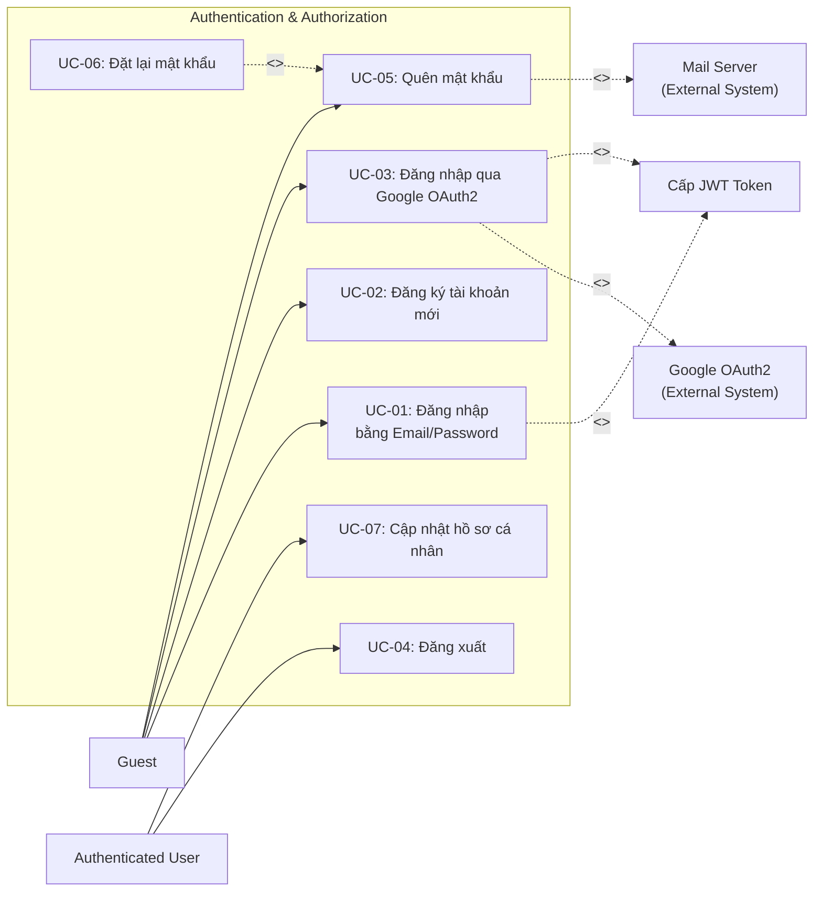

# UC01 – Xác thực & Phân quyền (Authentication & Authorization)

## Use Case Diagram

## Chi tiết Use Case

### UC-01: Đăng nhập bằng Email/Password

| Thuộc tính | Mô tả |
|------------|--------|
| **Actor** | Guest |
| **Mô tả** | Người dùng đăng nhập bằng email và mật khẩu đã đăng ký, hỗ trợ nút toggle ẩn/hiện mật khẩu |
| **Tiền điều kiện** | Đã có tài khoản trong hệ thống |
| **Luồng chính** | 1. Guest truy cập `/login`   2. Nhập email và password (có thể click icon con mắt để hiển thị/ẩn mật khẩu)   3. Hệ thống xác thực thông tin bằng BCrypt   4. Cấp JWT Token lưu vào Cookie `UTELearn_Token` (HTTP-Only, SameSite)   5. Redirect theo role: Admin -> `/dashboard`, Others -> `/home` |
| **Luồng ngoại lệ** | - Sai mật khẩu -> Hiển thị lỗi thông báo   - Tài khoản bị khóa (`status = INACTIVE`) -> Thông báo liên hệ quản trị viên |
| **Hậu điều kiện** | User đã đăng nhập, JWT Token hợp lệ trong cookie |

### UC-02: Đăng ký tài khoản xác thực Email OTP

| Thuộc tính | Mô tả |
|------------|--------|
| **Actor** | Guest |
| **Mô tả** | Đăng ký tài khoản mới với cơ chế xác thực Email qua mã OTP 6 số (gửi qua Brevo SMTP) bảo vệ chống spam và email giả mạo |
| **Tiền điều kiện** | Chưa có tài khoản gắn với email đăng ký |
| **Luồng chính** | 1. Guest truy cập `/register`.   2. Nhập Địa chỉ Email và bấm nút **"Gửi mã OTP"** (gọi API `/api/auth/send-registration-otp`).   3. Hệ thống kiểm tra:   &nbsp;&nbsp;&nbsp;&nbsp;- Email hợp lệ định dạng và chưa tồn tại trong bảng `users`.   &nbsp;&nbsp;&nbsp;&nbsp;- Sinh mã OTP ngẫu nhiên 6 chữ số, thời hạn hiệu lực 5 phút.   &nbsp;&nbsp;&nbsp;&nbsp;- Lưu bản ghi vào bảng `registration_otps` (`email`, `otp_code`, `expired_at`, `is_used = false`).   &nbsp;&nbsp;&nbsp;&nbsp;- Gửi email chứa mã OTP đến hòm thư người dùng qua dịch vụ Brevo SMTP.   4. Giao diện hiển thị đếm ngược 60 giây và mở ô nhập mã OTP.   5. Người dùng điền Họ tên, Mật khẩu, Xác nhận mật khẩu (có nút toggle xem mật khẩu) và nhập Mã OTP 6 số nhận được từ email.   6. Người dùng nhấn nút **"Hoàn tất đăng ký"**.   7. Hệ thống xác thực:   &nbsp;&nbsp;&nbsp;&nbsp;- Kiểm tra mã OTP khớp và chưa hết hạn trong `registration_otps`.   &nbsp;&nbsp;&nbsp;&nbsp;- Đánh dấu `is_used = true` cho mã OTP.   &nbsp;&nbsp;&nbsp;&nbsp;- Mã hóa mật khẩu bằng BCrypt, tạo bản ghi `users` với vai trò mặc định `ROLE_STUDENT`.   8. Hệ thống cấp Cookie JWT và tự động chuyển hướng người dùng đến `/home`. |
| **Luồng ngoại lệ** | - **Email đã tồn tại**: Báo lỗi "Email này đã được đăng ký tài khoản".   - **Mã OTP sai hoặc hết hạn**: Báo lỗi "Mã xác thực OTP không chính xác hoặc đã hết hạn".   - **Mật khẩu không khớp**: Hiển thị cảnh báo trực quan tại ô nhập xác nhận mật khẩu. |
| **Hậu điều kiện** | Tài khoản mới được xác thực email thực tế, kích hoạt thành công với role STUDENT |

### UC-03: Đăng nhập qua Google OAuth2

| Thuộc tính | Mô tả |
|------------|--------|
| **Actor** | Guest |
| **Mô tả** | Đăng nhập bằng tài khoản Google, hệ thống tự động tạo tài khoản nếu chưa có |
| **Tiền điều kiện** | Có tài khoản Google hợp lệ |
| **Luồng chính** | 1. Guest click "Đăng nhập với Google"   2. Redirect đến Google OAuth2 consent screen   3. Xác thực thành công -> Callback về hệ thống   4. Hệ thống kiểm tra email, tự tạo account nếu cần (gán `auth_provider = GOOGLE`)   5. Cấp JWT Token -> Redirect theo role |
| **Luồng ngoại lệ** | - Từ chối ủy quyền -> Quay lại `/login` |
| **Hậu điều kiện** | User đăng nhập thành công |

### UC-04: Đăng xuất

| Thuộc tính | Mô tả |
|------------|--------|
| **Actor** | Authenticated User (tất cả roles) |
| **Mô tả** | Thoát khỏi phiên làm việc hiện tại |
| **Luồng chính** | 1. Click "Đăng xuất"   2. Xóa cookie `UTELearn_Token` và `JSESSIONID`   3. Redirect -> `/login?logout=true` |
| **Hậu điều kiện** | JWT Token bị xóa, session kết thúc |

### UC-05: Quên mật khẩu

| Thuộc tính | Mô tả |
|------------|--------|
| **Actor** | Guest |
| **Mô tả** | Yêu cầu reset mật khẩu qua email xác thực Brevo SMTP |
| **Luồng chính** | 1. Guest truy cập `/forgot-password`   2. Nhập email đã đăng ký   3. Hệ thống tạo token reset lưu vào `password_reset_tokens` và gửi email qua Brevo SMTP   4. Hiển thị thông báo "Đã gửi email khôi phục mật khẩu" |
| **Luồng ngoại lệ** | - Email không tồn tại -> Vẫn hiển thị thông báo thành công để chống tấn công dò quét email |

### UC-06: Đặt lại mật khẩu

| Thuộc tính | Mô tả |
|------------|--------|
| **Actor** | Guest (có token hợp lệ) |
| **Mô tả** | Đặt mật khẩu mới thông qua link reset, hỗ trợ xem/ẩn mật khẩu |
| **Luồng chính** | 1. Click link trong email `/reset-password?token=xxx`   2. Nhập mật khẩu mới và xác nhận mật khẩu (có nút toggle xem mật khẩu)   3. Hệ thống validate token còn hạn và cập nhật password mã hóa BCrypt   4. Đánh dấu hủy token cũ và redirect -> `/login?reset=success` |
| **Luồng ngoại lệ** | - Token hết hạn hoặc không hợp lệ -> Hiển thị thông báo lỗi yêu cầu gửi lại yêu cầu |

### UC-07: Cập nhật hồ sơ cá nhân

| Thuộc tính | Mô tả |
|------------|--------|
| **Actor** | Authenticated User |
| **Mô tả** | Cập nhật thông tin cá nhân (họ tên, SĐT, avatar...) |
| **Luồng chính** | 1. Truy cập `/profile`   2. Chỉnh sửa thông tin (fullName, phone, avatar)   3. Submit form -> Validate -> Lưu DB   4. Hiển thị toast thành công |
| **Hậu điều kiện** | Thông tin profile được cập nhật |
