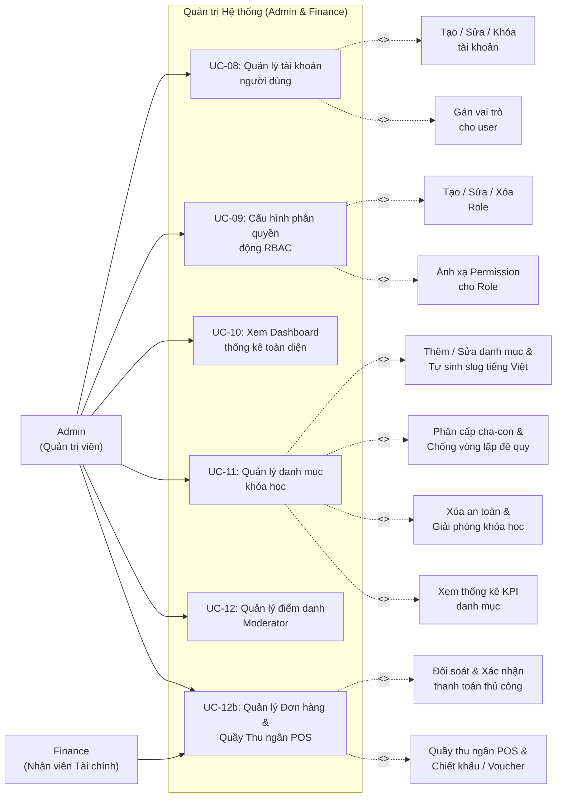

# UC02 – Quản trị Hệ thống (Admin Module)

## Use Case Diagram

## Chi tiết Use Case

### UC-08: Quản lý tài khoản người dùng

| Thuộc tính | Mô tả |
|------------|--------|
| **Actor** | Admin |
| **Permission** | `USER_MANAGE` |
| **Mô tả** | CRUD tài khoản, gán vai trò, kích hoạt / khóa tài khoản |
| **Tiền điều kiện** | Admin đã đăng nhập, có quyền `USER_MANAGE` |
| **Luồng chính** | 1. Admin truy cập `/admin/users`   2. Xem danh sách user (phân trang, tìm kiếm)   3. Click vào user -> Xem / Sửa thông tin   4. Gán / Gỡ vai trò   5. Kích hoạt / Vô hiệu hóa tài khoản |
| **Hậu điều kiện** | Thông tin user được cập nhật trong DB |

### UC-09: Cấu hình phân quyền động RBAC

| Thuộc tính | Mô tả |
|------------|--------|
| **Actor** | Admin |
| **Permission** | `ROLE_MANAGE` |
| **Mô tả** | Quản lý Roles và Permissions, ánh xạ permission cho từng role |
| **Luồng chính** | 1. Admin truy cập `/admin/roles`   2. Xem danh sách Role hiện có   3. Tạo mới / Chỉnh sửa Role   4. Tick chọn các Permission áp dụng cho Role   5. Lưu -> Hệ thống cập nhật bảng `role_permissions` |
| **Luồng ngoại lệ** | - Xóa role đang được gán -> Cảnh báo |

### UC-10: Xem Dashboard thống kê

| Thuộc tính | Mô tả |
|------------|--------|
| **Actor** | Admin |
| **Mô tả** | Xem tổng quan hệ thống: số user, khóa học, doanh thu, hoạt động theo mốc thời gian |
| **Luồng chính** | 1. Admin truy cập `/dashboard`   2. Hệ thống hiển thị KPIs:   - Tổng số user, instructor, student   - Số khóa học (theo trạng thái)   - Doanh thu theo ngày/tuần/tháng/tất cả   - Hoạt động gần đây |

### UC-11: Quản lý danh mục khóa học (Category CRUD)

| Thuộc tính | Mô tả |
|------------|--------|
| **Actor** | Admin |
| **Permission** | `ROLE_ADMIN` |
| **Mô tả** | Quản lý danh mục khóa học đa cấp (Category CRUD), hỗ trợ tự động sinh slug tiếng Việt chuẩn hóa, phân cấp cha-con, thuật toán chống vòng lặp đệ quy, hiển thị KPI widget và giải phóng an toàn khóa học khi xóa. |
| **Tiền điều kiện** | Admin đã đăng nhập với vai trò Quản trị viên (`ADMIN`). |
| **Luồng chính** | 1. Admin truy cập `/admin/categories`. 2. Hệ thống hiển thị 4 widget KPI (Tổng danh mục, Danh mục gốc, Danh mục con, Tổng khóa học) cùng bảng danh sách danh mục phân trang và tìm kiếm. 3. Admin nhấn **"Thêm danh mục"** (`/admin/categories/create`) hoặc nút **"Sửa"** (`/admin/categories/edit/{id}`). 4. Admin nhập Tên danh mục -> Giao diện tự động sinh Slug tiếng Việt không dấu chuẩn hóa SEO (có thể tinh chỉnh thủ công). 5. Admin chọn Danh mục cha từ danh sách (hoặc để trống nếu là danh mục gốc). 6. Admin nhấn **"Lưu danh mục"**. 7. Server kiểm tra tính hợp lệ dữ liệu: tên không rỗng, slug duy nhất không trùng lặp, chống gán danh mục cha là chính nó hoặc con cháu của nó (chống vòng lặp đệ quy). 8. Dữ liệu được lưu vào bảng `categories`, hiển thị thông báo thành công. |
| **Luồng ngoại lệ** | - Trùng slug: Hệ thống báo lỗi "Slug danh mục đã tồn tại". - Phát hiện vòng lặp cha-con: Hệ thống ném ngoại lệ và yêu cầu chọn danh mục cha hợp lệ. - Khi xóa danh mục: Bật Modal xác nhận `#deleteCategoryModal`. Hệ thống tự động gán `category_id = NULL` cho các Course liên quan để bảo toàn khóa học và xử lý an toàn các danh mục con. |
| **Hậu điều kiện** | Cấu trúc danh mục khóa học được cập nhật tức thì trên toàn hệ thống (bao gồm Navbar, bộ lọc khóa học và form biên soạn khóa học). |

### UC-12: Quản lý điểm danh Moderator

| Thuộc tính | Mô tả |
|------------|--------|
| **Actor** | Admin |
| **Mô tả** | Theo dõi và quản lý bảng điểm danh của Moderator |
| **Luồng chính** | 1. Admin truy cập `/admin/attendance`   2. Xem danh sách điểm danh theo ngày/tuần   3. Xác nhận / Từ chối ca làm việc |

### UC-12b: Quản lý Đơn hàng & Quầy Thu ngân POS (Order Management & Cashier POS)

| Thuộc tính | Mô tả |
|------------|--------|
| **Actor** | Admin, Finance |
| **Permission** | `ORDER_MANAGE` |
| **Mô tả** | Quản lý danh sách đơn hàng toàn hệ thống, đối soát hóa đơn thanh toán VietQR SePay, phê duyệt thanh toán thủ công, hủy đơn và vận hành quầy thu ngân POS bán khóa học trực tiếp kèm mã giảm giá |
| **Tiền điều kiện** | Người dùng đăng nhập có vai trò `ADMIN` hoặc `FINANCE` với quyền `ORDER_MANAGE` |
| **Luồng chính** | 1. Admin/Finance truy cập `/admin/orders`. 2. Giao diện hiển thị các chỉ số tổng quan: Tổng doanh thu, Đơn thành công (`SUCCESS`), Đơn chờ thanh toán (`PENDING`), Đơn đã hủy (`CANCELLED`). 3. Tra cứu đơn hàng theo mã đơn `UTE...`, tên/email học viên, lọc theo khoảng thời gian và trạng thái. 4. **Nghiệp vụ Đối soát thủ công**: Với các đơn chuyển khoản trực tiếp qua ngân hàng mà webhook chậm hoặc đối soát tay, bấm **"Xác nhận thanh toán"** (`manualConfirmPayment`) -> Hệ thống cập nhật `status = SUCCESS`, lưu `paidAt = Instant.now()`, và tự động kích hoạt học viên vào `cohort_members` & `enrollments`. 5. **Nghiệp vụ Quầy Thu ngân POS (Cashier POS)**: &nbsp;&nbsp;&nbsp;&nbsp;- Bấm **"Mở Quầy POS"**, chọn tài khoản học viên cần ghi danh. &nbsp;&nbsp;&nbsp;&nbsp;- Chọn các Course hoặc Cohort thành phần cần bán (hỗ trợ nhiều sản phẩm cùng lúc). &nbsp;&nbsp;&nbsp;&nbsp;- Nhập mã Voucher giảm giá hoặc chiết khấu thủ công (`discountAmount`). &nbsp;&nbsp;&nbsp;&nbsp;- Xác nhận thanh toán tiền mặt/chuyển khoản quầy -> Hệ thống tự động sinh đơn hàng thành công và cấp quyền truy cập ngay lập tức cho học viên. |
| **Luồng ngoại lệ** | - Đơn hàng đã ở trạng thái `SUCCESS` hoặc `CANCELLED`: Không cho phép thao tác trùng lặp. - Khi hủy đơn (`cancelOrder`): Hệ thống cập nhật trạng thái `CANCELLED` và giải phóng chỗ nếu cần. |
| **Hậu điều kiện** | Doanh thu được ghi nhận chính xác, học viên được kích hoạt khóa học tự động và lưu vết đầy đủ trong bảng `orders`. |

