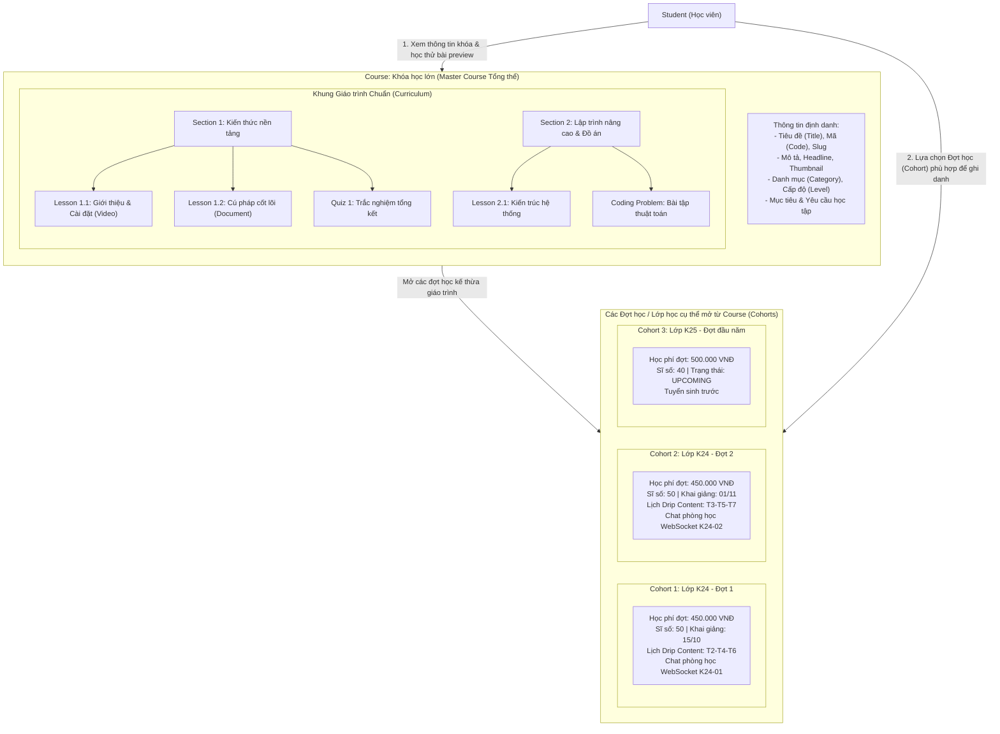
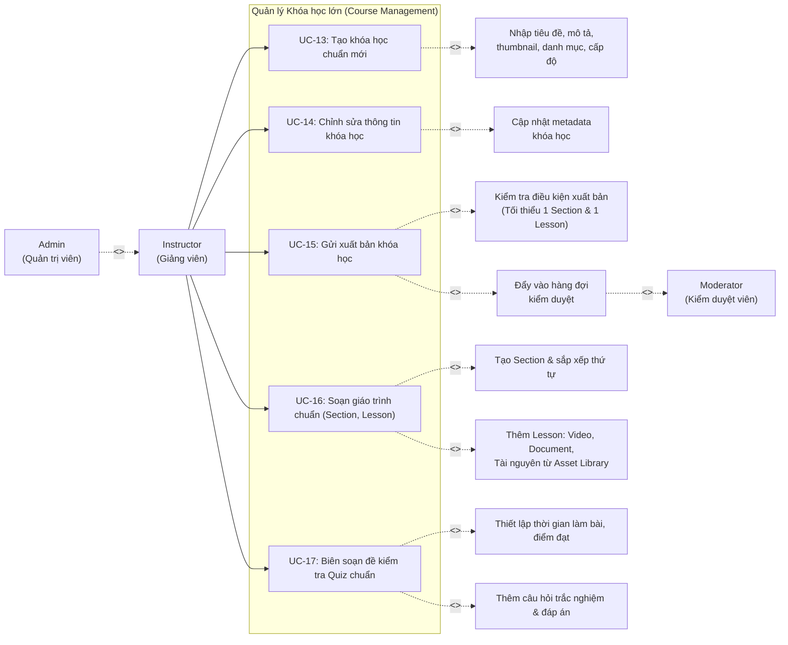

# UC03 – Quản lý Khóa học (Course Management – Instructor)

## 1. Mô hình Phân cấp Khóa học & Cohort

---

## 2. Use Case Diagram

---

## 3. Chi tiết Use Case

### UC-13: Tạo khóa học chuẩn mới

| Thuộc tính | Chi tiết mô tả |
|------------|----------------|
| **Mã Use Case** | UC-13 |
| **Tên Use Case** | Tạo khóa học chuẩn mới (Create Master Course) |
| **Actor chính** | Instructor |
| **Actor phụ** | Admin (thừa kế quyền) |
| **Quyền hạn (Permission)** | `COURSE_CREATE` |
| **Tiền điều kiện** | Giảng viên đã đăng nhập thành công vào hệ thống. |
| **Mô tả** | Giảng viên tạo khung chương trình khóa học chuẩn (Course). Khóa học này đóng vai trò là chương trình tổng thể, chứa giáo trình gốc và là cơ sở để mở các Đợt học (Cohorts) sau này. |
| **Luồng sự kiện chính** | 1. Giảng viên truy cập vào menu `/instructor/courses/create`. 2. Hệ thống hiển thị form tạo khóa học gồm các trường: &nbsp;&nbsp;&nbsp;&nbsp;- Mã khóa học (`code` - duy nhất, ví dụ: `CS101-JAVA`). &nbsp;&nbsp;&nbsp;&nbsp;- Tên khóa học (`title`). &nbsp;&nbsp;&nbsp;&nbsp;- Danh mục (`category_id` - chọn từ danh mục có sẵn). &nbsp;&nbsp;&nbsp;&nbsp;- Tiêu đề ngắn (`headline`) và Mô tả chi tiết (`description`). &nbsp;&nbsp;&nbsp;&nbsp;- Ảnh bìa đại diện (`thumbnail_url`). &nbsp;&nbsp;&nbsp;&nbsp;- Cấp độ (`level`: BEGINNER / INTERMEDIATE / ADVANCED / ALL_LEVELS). &nbsp;&nbsp;&nbsp;&nbsp;- Mục tiêu đạt được (`objectives`) và Yêu cầu đầu vào (`requirements`). 3. Giảng viên nhấn nút **"Tạo khóa học"**. 4. Hệ thống kiểm tra tính hợp lệ dữ liệu (mã duy nhất, tiêu đề không rỗng). 5. Hệ thống lưu khóa học vào bảng `courses` với trạng thái ban đầu là `DRAFT`. 6. Hệ thống chuyển hướng giảng viên đến trang danh sách khóa học `/instructor/courses` kèm thông báo thành công. |
| **Luồng ngoại lệ** | - **4a. Trùng mã hoặc slug khóa học**: Hệ thống hiển thị thông báo lỗi yêu cầu đổi mã khóa học. - **4b. Thiếu trường bắt buộc**: Báo lỗi tương ứng ngay tại input vi phạm. |
| **Hậu điều kiện** | Khóa học mới được tạo ở trạng thái `DRAFT`, sẵn sàng để Giảng viên bắt đầu soạn giáo trình chuẩn. |

---

### UC-14: Chỉnh sửa thông tin khóa học

| Thuộc tính | Chi tiết mô tả |
|------------|----------------|
| **Mã Use Case** | UC-14 |
| **Tên Use Case** | Chỉnh sửa thông tin khóa học (Edit Course Metadata) |
| **Actor chính** | Instructor (chủ sở hữu khóa học) |
| **Quyền hạn (Permission)** | `COURSE_CREATE` |
| **Tiền điều kiện** | Khóa học tồn tại và thuộc quyền sở hữu của Giảng viên đăng nhập. |
| **Mô tả** | Cập nhật thông tin tổng thể của Course (tiêu đề, mô tả, ảnh đại diện, danh mục, cấp độ, mục tiêu). |
| **Luồng sự kiện chính** | 1. Giảng viên truy cập `/instructor/courses`. 2. Chọn khóa học cần chỉnh sửa -> vào `/instructor/courses/{id}/edit`. 3. Thay đổi các thông tin cần thiết. 4. Nhấn **"Cập nhật"**. 5. Hệ thống cập nhật bảng `courses` và thông báo cập nhật thành công qua Flash message. |
| **Luồng ngoại lệ** | - **Giảng viên không phải chủ sở hữu**: Hệ thống từ chối truy cập (HTTP 403 Forbidden). - **Khóa học đang ở trạng thái `PENDING_REVIEW`**: Khóa chỉnh sửa thông tin quan trọng để chờ kết quả kiểm duyệt. |
| **Hậu điều kiện** | Thông tin khóa học được cập nhật thành công. |

---

### UC-15: Gửi xuất bản khóa học

| Thuộc tính | Chi tiết mô tả |
|------------|----------------|
| **Mã Use Case** | UC-15 |
| **Tên Use Case** | Gửi xuất bản khóa học (Submit Course for Moderation) |
| **Actor chính** | Instructor |
| **Actor liên quan** | Moderator |
| **Tiền điều kiện** | Khóa học đang ở trạng thái `DRAFT` hoặc `REJECTED`. |
| **Mô tả** | Giảng viên hoàn tất xây dựng giáo trình khóa học chuẩn, gửi lên hệ thống để Ban Kiểm duyệt (Moderator) đánh giá chất lượng trước khi được phép mở lớp tuyển sinh công khai. |
| **Luồng sự kiện chính** | 1. Giảng viên vào trang quản lý khóa học `/instructor/courses`, click nút **"Gửi duyệt"** tại khóa học tương ứng. 2. Hệ thống kiểm tra điều kiện xuất bản: &nbsp;&nbsp;&nbsp;&nbsp;- Course phải có ít nhất 1 Chương (`Section`). &nbsp;&nbsp;&nbsp;&nbsp;- Có ít nhất 1 Bài học (`Lesson`) hợp lệ (đã có video hoặc tài liệu). 3. Nếu thỏa mãn điều kiện, hệ thống chuyển trạng thái `status` của Course từ `DRAFT` sang `PENDING_REVIEW`. 4. Hệ thống tự động tạo một nhiệm vụ kiểm duyệt (`ModerationTask`) với loại `COURSE`, ghi nhận vào hàng đợi kiểm duyệt cân bằng tải. 5. Hệ thống gửi thông báo xác nhận cho Giảng viên. |
| **Luồng ngoại lệ** | - **Chưa đủ giáo trình chuẩn**: Hệ thống hiển thị thông báo lỗi yêu cầu hoàn thiện bài học trước khi gửi duyệt. |
| **Vòng đời trạng thái** | `DRAFT` -> `PENDING_REVIEW` -> `PUBLISHED` (Nếu duyệt thành công) HOẶC `REJECTED` (Nếu bị từ chối kèm lý do). |

---

### UC-16: Soạn giáo trình chuẩn Course (Curriculum Management)

| Thuộc tính | Chi tiết mô tả |
|------------|----------------|
| **Mã Use Case** | UC-16 |
| **Tên Use Case** | Soạn giáo trình chuẩn Course (Manage Course Curriculum) |
| **Actor chính** | Instructor |
| **Mô tả** | Giảng viên xây dựng cây giáo trình chuẩn hoàn chỉnh của Khóa học gồm các Chương (Section) và Bài học (Lesson). Giáo trình này sẽ được dùng chung cho tất cả các Đợt học (Cohorts) mở sau này. |
| **Luồng sự kiện chính** | 1. Giảng viên mở giao diện soạn giáo trình tại `/instructor/courses/{id}/curriculum`. 2. **Thao tác Chương (Section)**: &nbsp;&nbsp;&nbsp;&nbsp;- Nhấn "Thêm chương mới", nhập tiêu đề chương. &nbsp;&nbsp;&nbsp;&nbsp;- Sắp xếp thứ tự các chương (`orderIndex`). 3. **Thao tác Bài học (Lesson)**: &nbsp;&nbsp;&nbsp;&nbsp;- Thêm bài học vào chương với loại nội dung: `VIDEO` hoặc `DOCUMENT`. &nbsp;&nbsp;&nbsp;&nbsp;- Nhập URL video hoặc chọn tệp đã tải lên từ Kho Tài nguyên (`InstructorAsset`). &nbsp;&nbsp;&nbsp;&nbsp;- Soạn thảo nội dung tài liệu (`document_content`) hoặc đính kèm tệp tài liệu. &nbsp;&nbsp;&nbsp;&nbsp;- Đánh dấu `is_free_preview` nếu cho phép học viên học thử bài này trước khi đăng ký. 4. Nhấn **"Lưu"**. Dữ liệu được cập nhật trực tiếp vào bảng `sections` và `lessons` gắn với `course_id`. |
| **Hậu điều kiện** | Khung giáo trình chuẩn của Course được hoàn thiện và lưu trữ an toàn. |

---

### UC-17: Biên soạn đề kiểm tra Quiz chuẩn

| Thuộc tính | Chi tiết mô tả |
|------------|----------------|
| **Mã Use Case** | UC-17 |
| **Tên Use Case** | Biên soạn đề kiểm tra Quiz chuẩn (Course Assessment Authoring) |
| **Actor chính** | Instructor |
| **Mô tả** | Giảng viên tạo các bài kiểm tra trắc nghiệm gắn với bài học hoặc chương học trong khóa học chuẩn. |
| **Luồng sự kiện chính** | 1. Giảng viên tạo bài học có loại `QUIZ` trong giáo trình chuẩn. 2. Thiết lập thông số bài thi: Thời lượng làm bài (`duration_minutes`), Điểm đạt tối thiểu (`passing_score`), Số lần làm tối đa. 3. Thêm danh sách câu hỏi trắc nghiệm (Nội dung câu hỏi, các lựa chọn đáp án `options JSONB`, đáp án đúng, giải thích câu trả lời). 4. Lưu đề kiểm tra vào bảng `quizzes` và `questions`. |
| **Hậu điều kiện** | Bộ đề kiểm tra Quiz chuẩn sẵn sàng để học viên trong các Đợt học (Cohorts) làm bài. |
