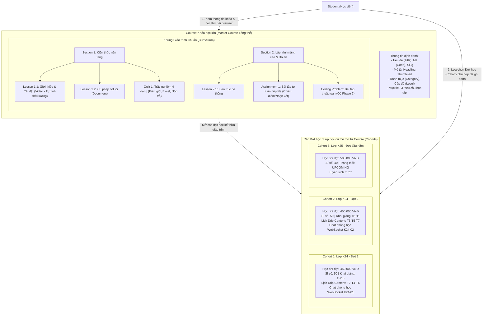
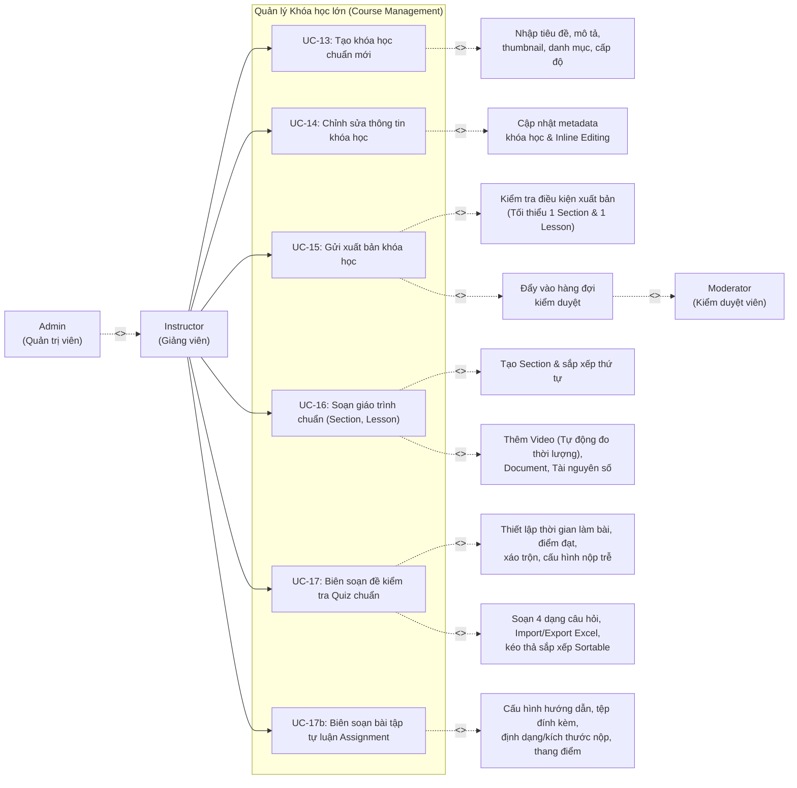

# UC03 – Quản lý Khóa học (Course Management – Instructor)

## 1. Mô hình Phân cấp Khóa học & Cohort

---

## 2. Use Case Diagram

---

## 3. Chi tiết Use Case

### UC-13: Tạo khóa học chuẩn mới

| Thuộc tính | Chi tiết mô tả |
|------------|----------------|
| **Mã Use Case** | UC-13 |
| **Tên Use Case** | Tạo khóa học chuẩn mới (Create Master Course) |
| **Actor chính** | Instructor |
| **Actor phụ** | Admin (thừa kế quyền) |
| **Quyền hạn (Permission)** | `COURSE_CREATE` |
| **Tiền điều kiện** | Giảng viên đã đăng nhập thành công vào hệ thống. |
| **Mô tả** | Giảng viên tạo khung chương trình khóa học chuẩn (Course). Khóa học này đóng vai trò là chương trình tổng thể, chứa giáo trình gốc và là cơ sở để mở các Đợt học (Cohorts) sau này. |
| **Luồng sự kiện chính** | 1. Giảng viên truy cập vào menu `/instructor/courses/create`. 2. Hệ thống hiển thị form tạo khóa học gồm các trường: &nbsp;&nbsp;&nbsp;&nbsp;- Mã khóa học (`code` - duy nhất, ví dụ: `CS101-JAVA`). &nbsp;&nbsp;&nbsp;&nbsp;- Tên khóa học (`title`). &nbsp;&nbsp;&nbsp;&nbsp;- Danh mục (`category_id` - chọn từ danh mục có sẵn). &nbsp;&nbsp;&nbsp;&nbsp;- Tiêu đề ngắn (`headline`) và Mô tả chi tiết (`description`). &nbsp;&nbsp;&nbsp;&nbsp;- Ảnh bìa đại diện (`thumbnail_url`). &nbsp;&nbsp;&nbsp;&nbsp;- Cấp độ (`level`: BEGINNER / INTERMEDIATE / ADVANCED / ALL_LEVELS). &nbsp;&nbsp;&nbsp;&nbsp;- Mục tiêu đạt được (`objectives`) và Yêu cầu đầu vào (`requirements`). 3. Giảng viên nhấn nút **"Tạo khóa học"**. 4. Hệ thống kiểm tra tính hợp lệ dữ liệu (mã duy nhất, tiêu đề không rỗng). 5. Hệ thống lưu khóa học vào bảng `courses` với trạng thái ban đầu là `DRAFT`. 6. Hệ thống chuyển hướng giảng viên đến trang danh sách khóa học `/instructor/courses` kèm thông báo thành công. |
| **Luồng ngoại lệ** | - **4a. Trùng mã hoặc slug khóa học**: Hệ thống hiển thị thông báo lỗi yêu cầu đổi mã khóa học. - **4b. Thiếu trường bắt buộc**: Báo lỗi tương ứng ngay tại input vi phạm. |
| **Hậu điều kiện** | Khóa học mới được tạo ở trạng thái `DRAFT`, sẵn sàng để Giảng viên bắt đầu soạn giáo trình chuẩn. |

---

### UC-14: Chỉnh sửa thông tin khóa học

| Thuộc tính | Chi tiết mô tả |
|------------|----------------|
| **Mã Use Case** | UC-14 |
| **Tên Use Case** | Chỉnh sửa thông tin khóa học (Edit Course Metadata) |
| **Actor chính** | Instructor (chủ sở hữu khóa học - `isOwner`) |
| **Actor phụ** | Admin (Quản trị viên toàn hệ thống) |
| **Quyền hạn (Permission)** | `COURSE_CREATE` |
| **Tiền điều kiện** | Khóa học tồn tại và thuộc quyền sở hữu của Giảng viên đăng nhập (hoặc tài khoản Admin). |
| **Mô tả** | Cập nhật thông tin tổng thể của Course (tiêu đề, mô tả, ảnh đại diện, danh mục, cấp độ, mục tiêu) thông qua form biên soạn hoặc chế độ chỉnh sửa trực tiếp tại chỗ (Inline Edit). |
| **Luồng sự kiện chính** | 1. **Cách 1 - Chỉnh sửa qua Form quản trị:** &nbsp;&nbsp;&nbsp;&nbsp;- Giảng viên truy cập `/instructor/courses` -> chọn khóa học -> vào `/instructor/courses/{id}/edit`. &nbsp;&nbsp;&nbsp;&nbsp;- Thay đổi các thông tin và nhấn "Cập nhật". 2. **Cách 2 - Chỉnh sửa trực tiếp tại chỗ (Inline Edit):** &nbsp;&nbsp;&nbsp;&nbsp;- Người có quyền (`canEdit = true`) xem trang chi tiết `/courses/{slug}`. &nbsp;&nbsp;&nbsp;&nbsp;- Bật công tắc *"Quyền Giảng viên / Quản trị - Bật chế độ chỉnh sửa"* (`courseDetailEditModeToggle`). &nbsp;&nbsp;&nbsp;&nbsp;- Bấm icon bút chì để sửa trực tiếp tiêu đề, mô tả ngắn, mục tiêu, cấp độ, mô tả chi tiết và lưu qua API inline. 3. Hệ thống cập nhật bảng `courses` và đồng bộ giao diện tức thì. |
| **Ràng buộc nghiệp vụ** | 1. **Nguyên tắc Phân định Sở hữu (`canEdit`)**: Chỉ Giảng viên tác giả (`isOwner`) hoặc Quản trị viên (`ADMIN`) mới có quyền bật/tắt chế độ chỉnh sửa và gọi API cập nhật inline. 2. **Chế độ Thẩm định của Moderator**: Kiểm duyệt viên (Moderator) khi xem demo khóa học chỉ có quyền xem xét (`hasAccessRole = true`, `canEdit = false`); hệ thống ẩn toàn bộ công tắc edit mode và chặn các API chỉnh sửa. |
| **Luồng ngoại lệ** | - **Giảng viên không phải chủ sở hữu hoặc Moderator cố tình gọi API sửa**: Hệ thống từ chối truy cập (HTTP 403 Forbidden). - **Khóa học đang ở trạng thái `PENDING_REVIEW` / `PENDING_MODERATOR`**: Khóa chỉnh sửa thông tin quan trọng để chờ kết quả kiểm duyệt. |
| **Hậu điều kiện** | Thông tin khóa học được cập nhật thành công. |

---

### UC-15: Gửi xuất bản khóa học

| Thuộc tính | Chi tiết mô tả |
|------------|----------------|
| **Mã Use Case** | UC-15 |
| **Tên Use Case** | Gửi xuất bản khóa học (Submit Course for Moderation) |
| **Actor chính** | Instructor |
| **Actor liên quan** | Moderator |
| **Tiền điều kiện** | Khóa học đang ở trạng thái `DRAFT` hoặc `REJECTED`. |
| **Mô tả** | Giảng viên hoàn tất xây dựng giáo trình khóa học chuẩn, gửi lên hệ thống để Ban Kiểm duyệt (Moderator) đánh giá chất lượng trước khi được phép mở lớp tuyển sinh công khai. |
| **Luồng sự kiện chính** | 1. Giảng viên vào trang quản lý khóa học `/instructor/courses`, click nút **"Gửi duyệt"** tại khóa học tương ứng. 2. Hệ thống kiểm tra điều kiện xuất bản: &nbsp;&nbsp;&nbsp;&nbsp;- Course phải có ít nhất 1 Chương (`Section`). &nbsp;&nbsp;&nbsp;&nbsp;- Có ít nhất 1 Bài học (`Lesson`) hợp lệ (đã có video hoặc tài liệu). 3. Nếu thỏa mãn điều kiện, hệ thống chuyển trạng thái `status` của Course từ `DRAFT` sang `PENDING_REVIEW`. 4. Hệ thống tự động tạo một nhiệm vụ kiểm duyệt (`ModerationTask`) với loại `COURSE`, ghi nhận vào hàng đợi kiểm duyệt cân bằng tải. 5. Hệ thống gửi thông báo xác nhận cho Giảng viên. |
| **Luồng ngoại lệ** | - **Chưa đủ giáo trình chuẩn**: Hệ thống hiển thị thông báo lỗi yêu cầu hoàn thiện bài học trước khi gửi duyệt. |
| **Vòng đời trạng thái** | `DRAFT` -> `PENDING_REVIEW` -> `PUBLISHED` (Nếu duyệt thành công) HOẶC `REJECTED` (Nếu bị từ chối kèm lý do). |

---

### UC-16: Soạn giáo trình chuẩn Course (Curriculum Management & Auto Video Duration)

| Thuộc tính | Chi tiết mô tả |
|------------|----------------|
| **Mã Use Case** | UC-16 |
| **Tên Use Case** | Soạn giáo trình chuẩn Course & Tự động đo thời lượng Video |
| **Actor chính** | Instructor |
| **Mô tả** | Giảng viên xây dựng cây giáo trình chuẩn hoàn chỉnh của Khóa học gồm các Chương (Section) và Bài học (Lesson). Hệ thống hỗ trợ tự động bóc tách và tính toán thời lượng video (phút:giây) khi giảng viên nhập URL hoặc chọn từ kho Cloudinary. Giáo trình này dùng chung cho tất cả các Đợt học (Cohorts) mở sau này. |
| **Luồng sự kiện chính** | 1. Giảng viên mở giao diện soạn giáo trình tại `/instructor/courses/{id}/curriculum` (hoặc `/instructor/cohorts/{id}/module-curriculum`). 2. **Thao tác Chương (Section)**: &nbsp;&nbsp;&nbsp;&nbsp;- Nhấn "Thêm chương mới", nhập tiêu đề chương. &nbsp;&nbsp;&nbsp;&nbsp;- Sắp xếp thứ tự các chương (`orderIndex`). 3. **Thao tác Bài học (Lesson)**: &nbsp;&nbsp;&nbsp;&nbsp;- Thêm bài học vào chương với loại nội dung: `VIDEO`, `DOCUMENT`, `QUIZ`, hoặc `ASSIGNMENT`. &nbsp;&nbsp;&nbsp;&nbsp;- Khi chọn `VIDEO`: Nhập URL video (YouTube, Vimeo, Cloudinary, MP4) hoặc chọn video từ Kho tài nguyên số (`InstructorAsset`). &nbsp;&nbsp;&nbsp;&nbsp;- **Cơ chế Tự động tính thời lượng Video (Auto Duration Calculation)**: Client bóc tách metadata thời lượng video thời gian thực hoặc gọi backend API để lưu trữ chính xác thời lượng (`durationMinutes`) hiển thị theo định dạng `mm:ss` trên toàn bộ giao diện học viên và kiểm duyệt viên. &nbsp;&nbsp;&nbsp;&nbsp;- Soạn thảo nội dung tài liệu (`document_content`) hoặc đính kèm tệp tài liệu. &nbsp;&nbsp;&nbsp;&nbsp;- Đánh dấu `is_free_preview` nếu cho phép học viên học thử bài này trước khi đăng ký. 4. Nhấn **"Lưu bài học"**. Dữ liệu được cập nhật trực tiếp vào bảng `sections` và `lessons` gắn với `course_id`. |
| **Hậu điều kiện** | Khung giáo trình chuẩn của Course được hoàn thiện, thời lượng bài học được tính toán đồng bộ và lưu trữ an toàn. |

---

### UC-17: Biên soạn đề kiểm tra Quiz chuẩn (4 Dạng câu hỏi, Excel Import/Export & Cấu hình nộp trễ)

| Thuộc tính | Chi tiết mô tả |
|------------|----------------|
| **Mã Use Case** | UC-17 |
| **Tên Use Case** | Biên soạn đề kiểm tra Quiz chuẩn (Course Assessment Authoring) |
| **Actor chính** | Instructor |
| **Mô tả** | Giảng viên tạo các bài kiểm tra trắc nghiệm gắn với bài học hoặc chương học trong khóa học chuẩn, thiết lập ngân hàng câu hỏi đa dạng 4 dạng cốt lõi, nhập/xuất tệp Excel và cấu hình các ràng buộc làm bài thi linh hoạt (bao gồm chính sách làm trễ). |
| **Luồng sự kiện chính** | 1. Giảng viên tạo bài học có loại `QUIZ` trong giáo trình chuẩn. 2. Bấm nút **"Soạn đề kiểm tra"** để mở modal cấu hình tham số bài thi: &nbsp;&nbsp;&nbsp;&nbsp;- Thời lượng làm bài (`durationMinutes` - phút, nhập 0 nếu không giới hạn). &nbsp;&nbsp;&nbsp;&nbsp;- Điểm đạt tối thiểu (`passingScore` - thang điểm 10.0, mặc định 5.0). &nbsp;&nbsp;&nbsp;&nbsp;- Số lần làm bài tối đa (`maxAttempts` - 0 nghĩa là không giới hạn). &nbsp;&nbsp;&nbsp;&nbsp;- Xáo trộn thứ tự câu hỏi (`shuffleQuestions` - true/false). &nbsp;&nbsp;&nbsp;&nbsp;- Cho phép xem lại bài làm và lời giải sau khi nộp (`allowReview`). &nbsp;&nbsp;&nbsp;&nbsp;- **Kiểm soát làm trễ sau hạn chót (`allowLateSubmission`)**: Tick chọn cho phép học viên tiếp tục làm bài thi khi đã quá deadline (hệ thống sẽ gắn cờ và badge cảnh báo "Làm trễ"), hoặc bỏ tick để khóa hoàn toàn quyền thi khi quá hạn. 3. **Soạn thảo Ngân hàng câu hỏi**: &nbsp;&nbsp;&nbsp;&nbsp;- Hỗ trợ **4 dạng câu hỏi**: Trắc nghiệm 1 đáp án (`SINGLE_CHOICE`), Trắc nghiệm nhiều đáp án (`MULTI_SELECT`), Đúng / Sai (`TRUE_FALSE`), Điền từ khuyết (`FILL_BLANK`). &nbsp;&nbsp;&nbsp;&nbsp;- Mỗi câu hỏi nhập nội dung, danh sách đáp án (`options` JSONB), đáp án đúng, điểm số và lời giải thích chi tiết. &nbsp;&nbsp;&nbsp;&nbsp;- **Tính năng Nhập/Xuất Excel**: Tải file mẫu (`template.xlsx`), nhập danh sách hàng chục câu hỏi nhanh từ Excel qua API `/api/instructor/quizzes/{id}/questions/import-excel`, xuất toàn bộ ngân hàng câu hỏi ra file Excel. &nbsp;&nbsp;&nbsp;&nbsp;- **Sắp xếp câu hỏi trực quan**: Kéo thả câu hỏi tự do bằng SortableJS hoặc nhấn mũi tên Up/Down để thay đổi `order_index` tức thì. 4. Nhấn **"Lưu cấu hình"**. Dữ liệu được lưu trữ an toàn trong các bảng `quizzes` và `questions`. |
| **Hậu điều kiện** | Bộ đề kiểm tra Quiz chuẩn sẵn sàng để học viên trong các Đợt học (Cohorts) làm bài và tự động chấm điểm. |

---

### UC-17b: Biên soạn bài tập tự luận Assignment

| Thuộc tính | Chi tiết mô tả |
|------------|----------------|
| **Mã Use Case** | UC-17b |
| **Tên Use Case** | Biên soạn bài tập tự luận Assignment (Manage Assignment Tasks) |
| **Actor chính** | Instructor |
| **Mô tả** | Giảng viên tạo và cấu hình bài tập tự luận nộp file (Project, Essay, Báo cáo, Code zip...) gắn với giáo trình chuẩn hoặc module độc lập. |
| **Luồng sự kiện chính** | 1. Trong giao diện soạn giáo trình `/instructor/courses/{id}/curriculum`, Giảng viên thêm bài học mới và chọn loại nội dung **`ASSIGNMENT`**. 2. Giảng viên cấu hình các tham số bài tập tự luận: &nbsp;&nbsp;&nbsp;&nbsp;- Tiêu đề bài tập (`title`). &nbsp;&nbsp;&nbsp;&nbsp;- Hướng dẫn làm bài chi tiết (`instructions`). &nbsp;&nbsp;&nbsp;&nbsp;- Tệp đính kèm đề bài mẫu hoặc tài liệu tham khảo (`attachmentUrl`). &nbsp;&nbsp;&nbsp;&nbsp;- Danh sách định dạng tệp cho phép nộp (`allowedFileTypes`: PDF, DOCX, ZIP, RAR, TXT, PPTX...). &nbsp;&nbsp;&nbsp;&nbsp;- Dung lượng tệp tối đa (`maxFileSizeMb`, ví dụ: 25 MB). &nbsp;&nbsp;&nbsp;&nbsp;- Thang điểm tối đa (`maxScore`, ví dụ: 10.0 hoặc 100). &nbsp;&nbsp;&nbsp;&nbsp;- Điểm đạt yêu cầu (`passingScore`, ví dụ: 5.0). &nbsp;&nbsp;&nbsp;&nbsp;- Loại đánh giá (`requiresGrading`): Bắt buộc Giảng viên chấm điểm (`true`) hoặc Chỉ nộp để nhận xét/điểm danh (`false`). 3. Giảng viên nhấn **"Lưu bài tập"**. 4. Hệ thống lưu trữ thông tin vào bảng `assignments` liên kết 1-1 với `lesson_id`. |
| **Hậu điều kiện** | Bài tập tự luận sẵn sàng để học viên theo dõi đề bài, tải tài liệu mẫu và nộp file bài làm. |
