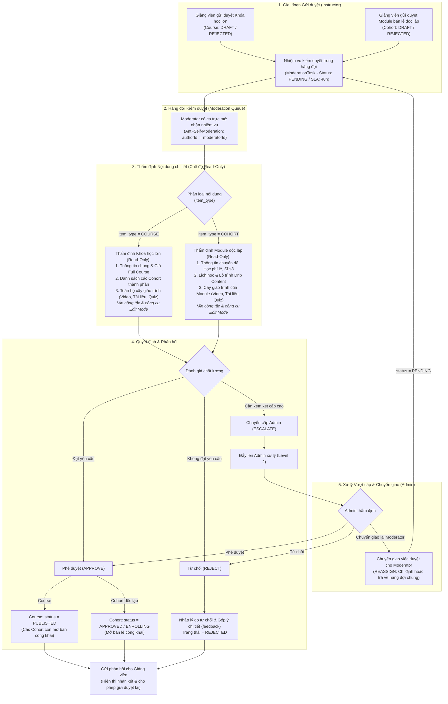
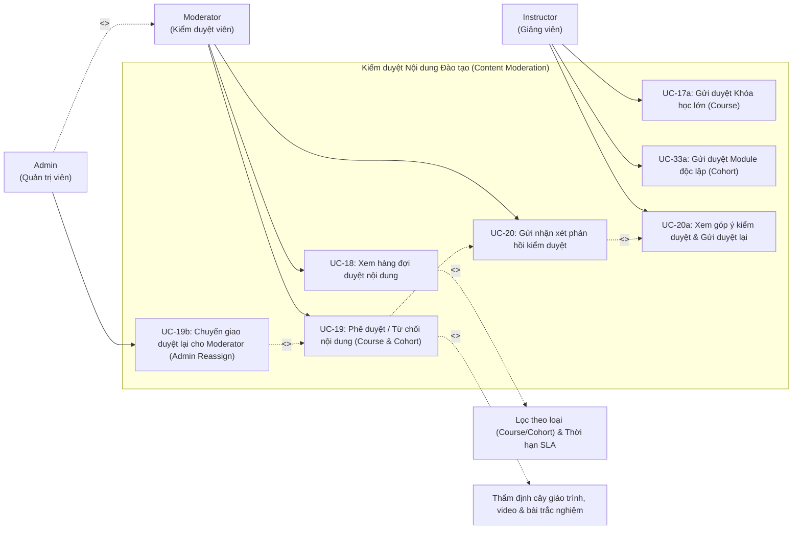

# UC04 – Kiểm duyệt Nội dung (Content Moderation)

## 1. Luồng Kiểm duyệt Khóa học (Course) & Module Độc lập (Cohort)

---

## 2. Use Case Diagram

---

## 3. Chi tiết Use Case

### UC-18: Xem hàng đợi duyệt nội dung

| Thuộc tính | Chi tiết mô tả |
|------------|----------------|
| **Mã Use Case** | UC-18 |
| **Tên Use Case** | Xem hàng đợi duyệt nội dung (View Moderation Queue) |
| **Actor chính** | Moderator |
| **Permission** | `CONTENT_APPROVE` |
| **Tiền điều kiện** | Moderator đã đăng nhập và đã điểm danh ca trực trong ngày (`moderator_attendances.is_active = true`). |
| **Mô tả** | Moderator xem danh sách các nội dung đào tạo (Khóa học lớn và Module bán lẻ độc lập) đang chờ duyệt, lọc theo loại nội dung (`item_type`), độ ưu tiên và thời hạn xử lý (SLA). |
| **Luồng sự kiện chính** | 1. Moderator truy cập vào `/moderator/queue`. 2. Hệ thống kiểm tra ca trực đang hoạt động của Moderator. 3. Hiển thị danh sách nhiệm vụ kiểm duyệt (`moderation_tasks`): &nbsp;&nbsp;&nbsp;&nbsp;- Mã task, Loại nội dung (Khóa học lớn / Module độc lập), Tên nội dung, Giảng viên tạo, Ngày gửi duyệt. &nbsp;&nbsp;&nbsp;&nbsp;- Thời gian ước tính cần kiểm duyệt (`estimated_review_minutes`). &nbsp;&nbsp;&nbsp;&nbsp;- Hạn chót xử lý (`deadline_at` theo cam kết SLA 48h). &nbsp;&nbsp;&nbsp;&nbsp;- Trạng thái (`PENDING`, `IN_REVIEW`, `ESCALATED`). 4. Moderator lọc theo loại nội dung, danh mục, ngày gửi, hoặc tìm kiếm theo tên. 5. Moderator chọn một task để bắt đầu thẩm định. |
| **Luồng ngoại lệ** | - Moderator chưa điểm danh vào ca trực -> Hệ thống yêu cầu điểm danh trước khi truy cập hàng đợi. |
| **Hậu điều kiện** | Task được gán cho Moderator (`status = IN_REVIEW`, `assigned_to = moderatorId`). |

---

### UC-19: Phê duyệt / Từ chối nội dung đào tạo (Khóa học lớn & Module độc lập)

| Thuộc tính | Chi tiết mô tả |
|------------|----------------|
| **Mã Use Case** | UC-19 |
| **Tên Use Case** | Phê duyệt / Từ chối nội dung đào tạo (Approve or Reject Course & Cohort) |
| **Actor chính** | Moderator |
| **Permission** | `CONTENT_APPROVE` |
| **Tiền điều kiện** | Moderator đang mở nhiệm vụ kiểm duyệt cụ thể (`task.id`). |
| **Mô tả** | Đánh giá toàn diện nội dung (Course hoặc Cohort độc lập) bao gồm cây giáo trình, video, bài giảng và đề kiểm tra, đưa ra quyết định duyệt để mở bán công khai hoặc từ chối kèm góp ý. |
| **Luồng sự kiện chính** | 1. Moderator xem trang chi tiết kiểm duyệt (`/moderator/review/{taskId}`): &nbsp;&nbsp;&nbsp;&nbsp;- **Nếu là Khóa học lớn (`item_type = COURSE`)**: Kiểm tra thông tin giới thiệu, ảnh thumbnail, học phí combo Full Course, danh sách các Cohort thành phần và cây giáo trình toàn bộ khóa học. &nbsp;&nbsp;&nbsp;&nbsp;- **Nếu là Module độc lập (`item_type = COHORT`)**: Kiểm tra tên module, học phí bán lẻ, sức chứa tối đa, hạn ghi danh, cấu hình Drip Content và các bài học/quiz riêng của Module. &nbsp;&nbsp;&nbsp;&nbsp;- Xem trực tiếp nội dung bài học: Video player, tài liệu đính kèm, cấu trúc câu hỏi trắc nghiệm. 2. Đưa ra quyết định thẩm định: &nbsp;&nbsp;&nbsp;&nbsp;- **Trường hợp Phê duyệt (Approve)**: Nhấn "Phê duyệt" -> Trạng thái nội dung chuyển thành `PUBLISHED` (Course) hoặc `APPROVED / ENROLLING` (Cohort). Nội dung lập tức hiển thị công khai trên hệ thống để học viên đăng ký. &nbsp;&nbsp;&nbsp;&nbsp;- **Trường hợp Từ chối (Reject)**: Nhấn "Từ chối" -> Kích hoạt UC-20 để nhập lý do và hướng dẫn sửa đổi. &nbsp;&nbsp;&nbsp;&nbsp;- **Trường hợp Chuyển cấp (Escalate)**: Khi nội dung phức tạp hoặc có tranh chấp bản quyền -> Chuyển nhiệm vụ lên Admin (`escalation_level = 2`). 3. Hệ thống cập nhật bảng `moderation_tasks` sang `APPROVED` hoặc `REJECTED`, ghi nhận thời gian hoàn tất và cộng điểm năng suất ca trực của Moderator. |
| **Ràng buộc nghiệp vụ** | 1. **Chống tự kiểm duyệt (Anti-Self-Moderation)**: Giảng viên không được phép tự kiểm duyệt nội dung do chính mình tạo ra (`author_id <> assigned_to`). 2. **Thẩm định Chỉ đọc & Phân định Trách nhiệm (Read-Only Inspection & Separation of Duties)**: Moderator chỉ có quyền thẩm định, đánh giá chất lượng (`canEdit = false`). Hệ thống tự động ẩn toàn bộ công tắc chỉnh sửa (Edit Mode Toggle), các nút inline edit và chặn các API cập nhật trực tiếp. Moderator tuyệt đối không được tự ý sửa nội dung/giáo trình của Giảng viên mà bắt buộc phải từ chối kèm phản hồi chi tiết (UC-20) để Giảng viên tự hoàn thiện. |
| **Hậu điều kiện** | Trạng thái nội dung được cập nhật chính xác trên toàn hệ thống và đồng bộ với bảng danh mục. |

---

### UC-19b: Chuyển giao duyệt lại cho Moderator (Admin Reassign / Delegate Moderation)

| Thuộc tính | Chi tiết mô tả |
|------------|----------------|
| **Mã Use Case** | UC-19b |
| **Tên Use Case** | Chuyển giao duyệt lại cho Moderator (Admin Reassign / Delegate Moderation) |
| **Actor chính** | Admin (Quản trị viên) |
| **Actor nhận** | Moderator (Kiểm duyệt viên) |
| **Permission** | `CONTENT_APPROVE` (Quyền Quản trị viên) |
| **Tiền điều kiện** | Admin đang mở xem xét nhiệm vụ kiểm duyệt (hoặc task ở trạng thái `ESCALATED`). |
| **Mô tả** | Quản trị viên sau khi xem xét nhiệm vụ vượt cấp nhận thấy có thể chuyển giao lại cho Kiểm duyệt viên (chỉ định 1 Moderator cụ thể hoặc trả về hàng đợi chung để Moderator trong ca trực nhận) kèm theo chỉ đạo/lưu ý chuyên môn cụ thể. |
| **Luồng sự kiện chính** | 1. Admin truy cập màn hình duyệt nội dung (`/moderator/review/{taskId}`). 2. Admin bấm nút **"Chuyển lại Moderator"**. 3. Hệ thống mở modal chuyển giao: &nbsp;&nbsp;&nbsp;&nbsp;- Chọn Moderator được chỉ định (hoặc chọn *"Trả về hàng đợi chung (Bất kỳ Moderator nào nhận)"*). &nbsp;&nbsp;&nbsp;&nbsp;- Nhập chỉ đạo / lý do chuyển giao (`note` - Bắt buộc). 4. Admin bấm **"Xác nhận chuyển"**. 5. Hệ thống cập nhật `moderation_tasks`: &nbsp;&nbsp;&nbsp;&nbsp;- `status = 'PENDING'` &nbsp;&nbsp;&nbsp;&nbsp;- `escalation_level = 1` &nbsp;&nbsp;&nbsp;&nbsp;- `assigned_to`: Gán Moderator được chỉ định (hoặc `null` nếu trả về hàng đợi chung). &nbsp;&nbsp;&nbsp;&nbsp;- `escalation_reason`: Lưu chỉ đạo của Admin. &nbsp;&nbsp;&nbsp;&nbsp;- Cập nhật trạng thái Course/Cohort về `PENDING_MODERATOR`. 6. Hệ thống hiển thị thông báo thành công và điều hướng Admin về hàng đợi vượt cấp (`/admin/moderation`). 7. Task xuất hiện trong hàng đợi `/moderator/queue` với huy hiệu chỉ đạo của Admin để Moderator thẩm định theo yêu cầu. |
| **Ràng buộc nghiệp vụ** | **Chống tự kiểm duyệt (Anti-Self-Moderation)**: Admin không được phép chỉ định tác giả của khóa học/module làm người kiểm duyệt (`targetModeratorId <> author_id`). |
| **Hậu điều kiện** | Task được hạ cấp về `PENDING` cấp 1, sẵn sàng cho Moderator thẩm định lại theo chỉ đạo của Admin. |

---

### UC-20: Gửi nhận xét phản hồi kiểm duyệt

| Thuộc tính | Chi tiết mô tả |
|------------|----------------|
| **Mã Use Case** | UC-20 |
| **Tên Use Case** | Gửi nhận xét phản hồi kiểm duyệt (Provide Moderation Feedback) |
| **Actor chính** | Moderator |
| **Actor nhận** | Instructor |
| **Tiền điều kiện** | Khóa học hoặc Module độc lập bị từ chối phê duyệt. |
| **Mô tả** | Gửi văn bản phản hồi chi tiết nêu rõ các điểm chưa đạt yêu cầu (chất lượng âm thanh video, bản quyền, tính chính xác của đề thi trắc nghiệm, cấu hình giá) để giảng viên chỉnh sửa. |
| **Luồng sự kiện chính** | 1. Khi Moderator chọn Từ chối, hệ thống hiển thị modal nhập phản hồi kiểm duyệt. 2. Moderator nhập các thông tin: &nbsp;&nbsp;&nbsp;&nbsp;- Lý do từ chối chính (Danh mục vi phạm: Bản quyền, Video lỗi, Nội dung chưa đạt chuẩn, Cấu hình giá/lộ trình chưa đúng). &nbsp;&nbsp;&nbsp;&nbsp;- Góp ý chi tiết (`feedback` - chỉ rõ bài học, chương cần sửa đổi). 3. Nhấn **"Xác nhận từ chối và gửi phản hồi"**. 4. Hệ thống lưu nội dung phản hồi vào `moderation_tasks.feedback` và cập nhật trạng thái `REJECTED`. 5. Hệ thống gửi thông báo Notification cho Giảng viên sở hữu. 6. Giảng viên truy cập danh sách Khóa học / Module sẽ thấy huy hiệu "Bị từ chối", có nút xem chi tiết góp ý của Moderator để chỉnh sửa và gửi duyệt lại (UC-20a). |
| **Hậu điều kiện** | Giảng viên nắm rõ nguyên nhân từ chối và tiến hành hoàn thiện nội dung. |

