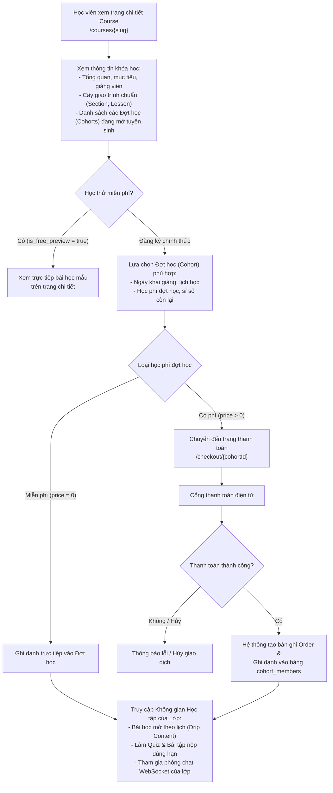
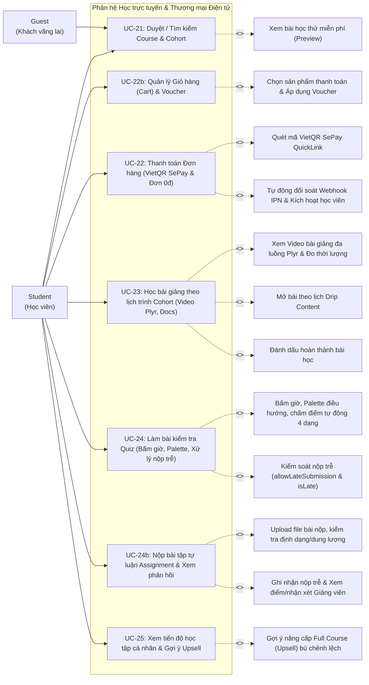

# UC05 – Học trực tuyến (Student Learning Module)

## 1. Luồng Nghiệp vụ Đăng ký & Học tập theo Đợt

---

## 2. Use Case Diagram

---

## 3. Chi tiết Use Case

### UC-21: Duyệt / Tìm kiếm Course & Cohort

| Thuộc tính | Chi tiết mô tả |
|------------|----------------|
| **Mã Use Case** | UC-21 |
| **Tên Use Case** | Duyệt / Tìm kiếm Course & Cohort (Browse & Search Courses) |
| **Actor chính** | Guest, Student |
| **Mô tả** | Người dùng xem danh mục, tìm kiếm và xem chi tiết Khóa học lớn (Course) cùng các Đợt học (Cohorts) đang mở tuyển sinh; có thể học thử video miễn phí, bấm "Thêm vào giỏ hàng" hoặc "Mua ngay". |
| **Luồng sự kiện chính** | 1. Người dùng truy cập trang chủ `/home` hoặc `/courses`. 2. Hệ thống hiển thị danh sách các khóa học đã được xuất bản (`status = PUBLISHED`). 3. Người dùng lọc theo: Danh mục (Category), Cấp độ (Beginner/Intermediate/Advanced), Từ khóa tìm kiếm. 4. Người dùng bấm vào một khóa học để xem trang chi tiết `/courses/{slug}`: &nbsp;&nbsp;&nbsp;&nbsp;- Tiêu đề, headline, mô tả chi tiết, giảng viên phụ trách, mục tiêu và yêu cầu. &nbsp;&nbsp;&nbsp;&nbsp;- Khung giáo trình chuẩn (các chương Section và bài học Lesson kèm thời lượng video). &nbsp;&nbsp;&nbsp;&nbsp;- Học thử các bài học có gắn cờ `is_free_preview`. &nbsp;&nbsp;&nbsp;&nbsp;- **Danh sách các Đợt học (Cohorts) đang tuyển sinh**: Tên đợt, mã lớp, học phí, sĩ số hiện tại/tối đa, thời gian khai giảng. 5. Học viên có thể bấm **"Thêm vào giỏ hàng"** để mua nhiều khóa học cùng lúc hoặc bấm **"Đăng ký ngay"** để chuyển thẳng sang trang thanh toán. |
| **Hậu điều kiện** | Người dùng nắm rõ thông tin và sẵn sàng chọn Đợt học phù hợp để thêm vào giỏ hàng hoặc đăng ký. |

---

### UC-22b: Quản lý Giỏ hàng (Cart) & Áp dụng Voucher giảm giá

| Thuộc tính | Chi tiết mô tả |
|------------|----------------|
| **Mã Use Case** | UC-22b |
| **Tên Use Case** | Quản lý Giỏ hàng & Voucher giảm giá (Shopping Cart & Voucher Checkout) |
| **Actor chính** | Student |
| **Tiền điều kiện** | Học viên đã đăng nhập tài khoản. |
| **Mô tả** | Học viên đưa các Course hoặc Cohort lẻ vào Giỏ hàng, xem tóm tắt đơn hàng, tích chọn các sản phẩm muốn thanh toán, áp dụng mã Voucher giảm giá và tiến hành đặt hàng. |
| **Luồng sự kiện chính** | 1. Học viên truy cập giỏ hàng `/cart` (icon giỏ hàng hiển thị số lượng badge trên Navbar). 2. Hệ thống hiển thị danh sách các mục trong giỏ (`cart_items`): Ảnh đại diện, Tên khóa học/module, Giảng viên, Giá tiền. 3. Học viên có thể tích chọn từng sản phẩm muốn thanh toán hoặc chọn tất cả. 4. Học viên nhập mã Voucher giảm giá vào ô khuyến mãi và nhấn "Áp dụng" -> Hệ thống kiểm tra điều kiện voucher (thời hạn, giá trị đơn tối thiểu, mức giảm tối đa) và tính toán số tiền giảm trừ (`discountAmount`). 5. Học viên nhấn **"Thanh toán các mục đã chọn"**. 6. Hệ thống tạo phiên thanh toán tại `/checkout` với danh sách sản phẩm và mức giảm giá tương ứng. |
| **Luồng ngoại lệ** | - Giỏ hàng rỗng: Hiển thị thông báo và nút khám phá khóa học. - Mã Voucher không hợp lệ hoặc không đủ điều kiện: Báo lỗi chi tiết bằng toast thông báo. |
| **Hậu điều kiện** | Danh sách sản phẩm được chọn và mã giảm giá được chuyển tiếp an toàn sang trang thanh toán. |

---

### UC-22: Thanh toán Đơn hàng theo Đợt học (VietQR SePay & Đơn 0đ)

| Thuộc tính | Chi tiết mô tả |
|------------|----------------|
| **Mã Use Case** | UC-22 |
| **Tên Use Case** | Thanh toán Đơn hàng (Order Checkout & VietQR SePay) |
| **Actor chính** | Student |
| **Tiền điều kiện** | Học viên đã đăng nhập tài khoản. |
| **Mô tả** | Học viên tiến hành thanh toán đơn hàng mua Full Course hoặc các Cohort lẻ thông qua chuyển khoản ngân hàng VietQR tự động (SePay Webhook IPN) hoặc xử lý tức thì đơn hàng 0 VNĐ. |
| **Luồng sự kiện chính** | 1. Tại trang thanh toán `/checkout`, học viên kiểm tra bảng kê chi tiết: Danh sách khóa học/module, đơn giá, số tiền giảm giá voucher (hoặc số tiền khấu trừ Upsell), tổng tiền cần thanh toán (`totalAmount`). 2. **Trường hợp 1 - Đơn hàng miễn phí (0 VNĐ)**: &nbsp;&nbsp;&nbsp;&nbsp;- Hệ thống tự động tạo đơn hàng với trạng thái `SUCCESS`. &nbsp;&nbsp;&nbsp;&nbsp;- Tự động ghi danh học viên vào `cohort_members` và `enrollments` mà không cần qua cổng thanh toán. &nbsp;&nbsp;&nbsp;&nbsp;- Chuyển hướng học viên ngay vào không gian học tập. 3. **Trường hợp 2 - Đơn hàng có phí (> 0 VNĐ)**: &nbsp;&nbsp;&nbsp;&nbsp;- Hệ thống tạo bản ghi `orders` với trạng thái `PENDING` và mã đơn duy nhất `UTE...`. &nbsp;&nbsp;&nbsp;&nbsp;- Hiển thị màn hình thanh toán VietQR `/payment/{orderCode}` kèm mã QR ngân hàng chuẩn SePay QuickLink (chứa số tài khoản, số tiền và nội dung chuyển khoản chính xác). &nbsp;&nbsp;&nbsp;&nbsp;- Client tự động kích hoạt polling thăm dò trạng thái mỗi 3 giây qua AJAX `/api/orders/{orderCode}/status`. &nbsp;&nbsp;&nbsp;&nbsp;- Khi học viên quét mã chuyển khoản thành công, SePay gửi Webhook IPN đến `/api/webhooks/sepay`. &nbsp;&nbsp;&nbsp;&nbsp;- Hệ thống kiểm tra chữ ký bảo mật, đối soát số tiền và mã đơn hàng, tự động chuyển đơn sang `SUCCESS`, ghi nhận `paidAt`, gửi email biên lai thanh toán qua Brevo SMTP và tự động ghi danh học viên. &nbsp;&nbsp;&nbsp;&nbsp;- Trình duyệt tự động chuyển hướng học viên đến màn hình thành công và lớp học. |
| **Luồng ngoại lệ** | - Lớp học đã đủ sĩ số tối đa -> Thông báo lớp đã đầy. - Đơn hàng hết hạn thanh toán -> Báo hủy đơn và chuyển hướng về giỏ hàng. |
| **Hậu điều kiện** | Học viên được cấp quyền truy cập đầy đủ vào các bài học và phòng chat của Đợt học đó. |

---

### UC-23: Học bài giảng theo lịch trình Cohort

| Thuộc tính | Chi tiết mô tả |
|------------|----------------|
| **Mã Use Case** | UC-23 |
| **Tên Use Case** | Học bài giảng theo lịch trình Cohort (Study Lessons within Cohort Schedule) |
| **Actor chính** | Student |
| **Actor hỗ trợ** | TA, Instructor |
| **Tiền điều kiện** | Học viên đã ghi danh thành công vào Đợt học (`cohort_members`). |
| **Mô tả** | Học viên truy cập không gian học tập của khóa học, xem bài giảng video đa luồng (Plyr), đọc tài liệu trực tuyến (PDF/Office) mở theo lịch trình điều phối Drip Content của Đợt học, theo dõi thời lượng bài học chuẩn xác. |
| **Luồng sự kiện chính** | 1. Học viên vào trang học tập `/courses/{slug}/learn` (hoặc `/modules/{id}/learn`). 2. Sidebar hiển thị toàn bộ giáo trình các chương (Section) và bài học (Lesson) kèm huy hiệu thời lượng (`mm:ss`). 3. Với mỗi bài học, hệ thống kiểm tra trạng thái mở khóa theo bảng `cohort_schedules` của Đợt học: &nbsp;&nbsp;&nbsp;&nbsp;- Nếu bài học đã đến thời gian mở (`unlock_at <= hiện tại`): Học viên bấm vào để xem Video bài giảng (hỗ trợ điều chỉnh tốc độ, lưu tiến độ qua Plyr) hoặc đọc tài liệu trực tuyến. &nbsp;&nbsp;&nbsp;&nbsp;- Nếu bài học chưa đến thời gian mở: Hiển thị icon khóa kèm thông báo thời điểm sẽ mở bài (Drip Content). 4. Khi học xong, học viên nhấn nút **"Đánh dấu hoàn thành"**. 5. Hệ thống lưu tiến độ vào `lesson_completions`, cập nhật % tiến độ thời gian thực trên thanh tiến độ và tự động mở bài tiếp theo. |
| **Hậu điều kiện** | Tiến độ học tập của học viên được cập nhật chính xác trong cơ sở dữ liệu. |

---

### UC-24: Làm bài kiểm tra Quiz theo Cohort (Bấm giờ, Palette, Kiểm soát nộp trễ)

| Thuộc tính | Chi tiết mô tả |
|------------|----------------|
| **Mã Use Case** | UC-24 |
| **Tên Use Case** | Làm bài kiểm tra Quiz theo Cohort (Take Cohort Assessment Quiz) |
| **Actor chính** | Student |
| **Tiền điều kiện** | Học viên đã ghi danh vào Đợt học và bài kiểm tra đã đến thời điểm mở khóa. |
| **Mô tả** | Học viên làm bài kiểm tra trắc nghiệm 4 dạng cốt lõi theo thời gian quy định, tương tác qua bảng điều hướng Palette, đồng hồ đếm ngược và nộp bài trước hạn chót (`deadline_at`) của Đợt học (với cơ chế kiểm soát làm trễ chặt chẽ). |
| **Luồng sự kiện chính** | 1. Học viên mở bài kiểm tra Quiz trong cây bài học. 2. Màn hình tổng quan hiển thị 4 chỉ số chuẩn mực (Số câu hỏi, Thời gian làm bài, Điểm đạt, Số lần làm tối đa), điểm số cao nhất của học viên và thời hạn nộp bài (`deadlineAtDisplay`). 3. **Kiểm tra điều kiện bắt đầu**: &nbsp;&nbsp;&nbsp;&nbsp;- Nếu bài thi đã quá hạn deadline và giảng viên cài đặt **`allowLateSubmission = false`**: Hệ thống khóa nút bắt đầu thi, hiển thị cảnh báo đỏ quá hạn và chặn làm bài. &nbsp;&nbsp;&nbsp;&nbsp;- Nếu bài thi đã quá hạn deadline nhưng giảng viên cho phép **`allowLateSubmission = true`**: Hiển thị cảnh báo vàng thông báo bài thi sẽ bị đánh dấu "Làm trễ". 4. Học viên nhấn **"Bắt đầu làm bài"** -> Hệ thống tải đề thi (ẩn cờ đáp án đúng), kích hoạt đồng hồ đếm ngược và thanh cố định khi thi. 5. Học viên trả lời các câu hỏi: Chọn 1 đáp án, chọn nhiều đáp án, chọn Đúng/Sai, điền từ vào ô trống. Bảng Palette hiển thị màu sắc câu đã làm / chưa làm. 6. Học viên nhấn **"Nộp bài"** (hoặc hệ thống tự động nộp khi hết giờ đếm ngược). 7. Server chấm điểm tự động theo thang 10.0, lưu bản ghi vào `quiz_submissions`: &nbsp;&nbsp;&nbsp;&nbsp;- Nếu nộp sau deadline: Lưu cờ `is_late = true`. &nbsp;&nbsp;&nbsp;&nbsp;- Nếu đạt điểm sàn (`score >= passingScore`): Tự động ghi nhận hoàn thành bài học vào `lesson_completions`. 8. Màn hình kết quả hiển thị điểm số, vòng tròn kết quả đạt/chưa đạt, tag "Làm trễ" (badge màu đỏ nổi bật nếu có) và khối xem lại chi tiết bài làm với đáp án đúng và lời giải thích. |
| **Luồng ngoại lệ** | - Quá số lần làm tối đa (`maxAttempts`): Hệ thống khóa nút thi lại và chỉ cho phép xem lịch sử bài nộp. |
| **Hậu điều kiện** | Điểm số và trạng thái nộp trễ được ghi nhận chính xác vào hồ sơ học tập của học viên. |

---

### UC-24b: Nộp bài tập tự luận Assignment & Xem phản hồi

| Thuộc tính | Chi tiết mô tả |
|------------|----------------|
| **Mã Use Case** | UC-24b |
| **Tên Use Case** | Nộp bài tập tự luận Assignment & Xem phản hồi (Submit Assignment & View Grade) |
| **Actor chính** | Student |
| **Tiền điều kiện** | Học viên đã ghi danh vào Đợt học và bài tập đã mở khóa. |
| **Mô tả** | Học viên xem hướng dẫn đề bài tập tự luận, tải tài liệu mẫu, nộp file bài làm và xem điểm số cùng lời nhận xét chi tiết của Giảng viên. |
| **Luồng sự kiện chính** | 1. Học viên mở bài học loại `ASSIGNMENT` trong phòng học `/courses/{slug}/learn`. 2. Giao diện hiển thị: Tiêu đề bài tập, Hạn chót nộp bài, Thang điểm, Hướng dẫn đề bài chi tiết và nút tải tệp đính kèm đề bài (nếu có). 3. Học viên chuẩn bị tệp bài làm theo đúng định dạng được phép (PDF, DOCX, ZIP...) và dung lượng tối đa quy định. 4. Học viên chọn tệp từ máy tính, nhập ghi chú bài nộp (nếu cần) và nhấn **"Xác nhận nộp bài"**. 5. Hệ thống tải tệp bài làm lên Cloudinary qua Backend Security Proxy, lưu bản ghi vào bảng `assignment_submissions` với trạng thái ban đầu là `SUBMITTED`. 6. **Kiểm tra thời hạn nộp bài**: &nbsp;&nbsp;&nbsp;&nbsp;- Nếu nộp sau thời điểm `deadline_at` của Cohort: Bản ghi được gắn cờ `is_late = true` và hiển thị badge đỏ **"Nộp trễ"**. 7. Giao diện học viên chuyển sang trạng thái **"ĐÃ NỘP • CHỜ CHẤM ĐIỂM"** (hiển thị tông màu hổ phách ấm `#fef3c7`, chữ `#92400e` chuẩn tương phản trợ năng kèm thông báo rõ ràng). 8. Khi Giảng viên chấm điểm xong: Trạng thái cập nhật thành `GRADED`, hiển thị điểm số đạt/chưa đạt kèm lời nhận xét (`feedback`) của Giảng viên; nếu đạt điểm sàn thì tự động đánh dấu hoàn thành bài học. |
| **Luồng ngoại lệ** | - Tệp nộp vượt quá dung lượng cho phép hoặc sai định dạng: Hệ thống báo lỗi và từ chối tải lên. |
| **Hậu điều kiện** | Bài nộp được lưu trữ an toàn và sẵn sàng cho Giảng viên vào chấm điểm. |

---

### UC-25: Xem tiến độ học tập cá nhân & Nâng cấp trọn gói (Upsell)

| Thuộc tính | Chi tiết mô tả |
|------------|----------------|
| **Mã Use Case** | UC-25 |
| **Tên Use Case** | Xem tiến độ học tập cá nhân & Gợi ý nâng cấp (View Learning Progress & Upsell) |
| **Actor chính** | Student |
| **Mô tả** | Học viên theo dõi tổng quan các khóa học và đợt học mình đã tham gia tại `/courses/my-courses`. Đối với các khóa học mới mua một số module lẻ, hệ thống hiển thị khối gợi ý Upsell nâng cấp trọn gói khóa học với chính sách chỉ bù phần tiền chênh lệch. |
| **Luồng sự kiện chính** | 1. Học viên truy cập trang cá nhân hoặc menu **"Khóa học của tôi"** (`/courses/my-courses`). 2. Hệ thống phân chia hiển thị theo 2 tab: "Trọn gói Khóa học" và "Module & Học phần lẻ" kèm thời gian học, tiến độ hoàn thành bài giảng. 3. Học viên nhấn **"Tiếp tục học"** để chuyển thẳng vào bài học đang dở dang. |
| **Luồng mở rộng (Extension - Upsell)** | **2a. Gợi ý nâng cấp Full Course (Upsell):** - Tại tab "Module & Học phần lẻ", với mỗi khóa học mẹ mà học viên mới sở hữu một số module, hệ thống hiển thị khối thẻ ưu đãi Nâng cấp trọn gói (Upgrade Upsell). - Hệ thống tự động tính toán số tiền chênh lệch: `Số tiền nâng cấp = Giá Full Course - Tổng số tiền đã thanh toán cho các Cohort trước đó`. - Hiển thị trực quan: Số module đã sở hữu / Tổng số module, số tiền đã khấu trừ 100%, số tiền bù thêm ưu đãi và số tiền tiết kiệm được so với mua lẻ. - Học viên bấm **"Nâng cấp trọn gói ngay"** -> Hệ thống chuyển hướng sang trang thanh toán `/checkout/course/{slug}` áp dụng đúng mức giá chênh lệch. - Sau khi xác nhận thanh toán thành công, toàn bộ các module còn lại của khóa học được tự động kích hoạt vào tài khoản học viên và chuyển khóa học sang tab "Trọn gói Khóa học". |
| **Hậu điều kiện** | Học viên nắm bắt tiến độ học tập của bản thân và có thể dễ dàng nâng cấp lên trọn gói khóa học tiết kiệm chi phí. |
