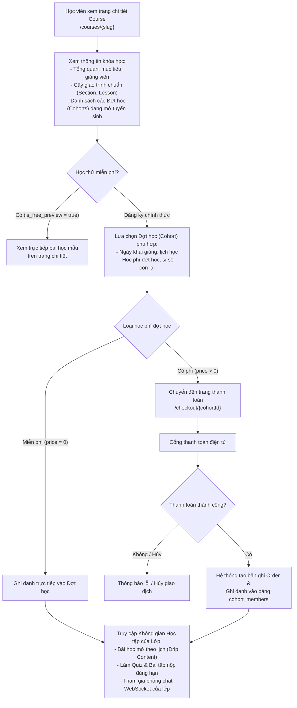
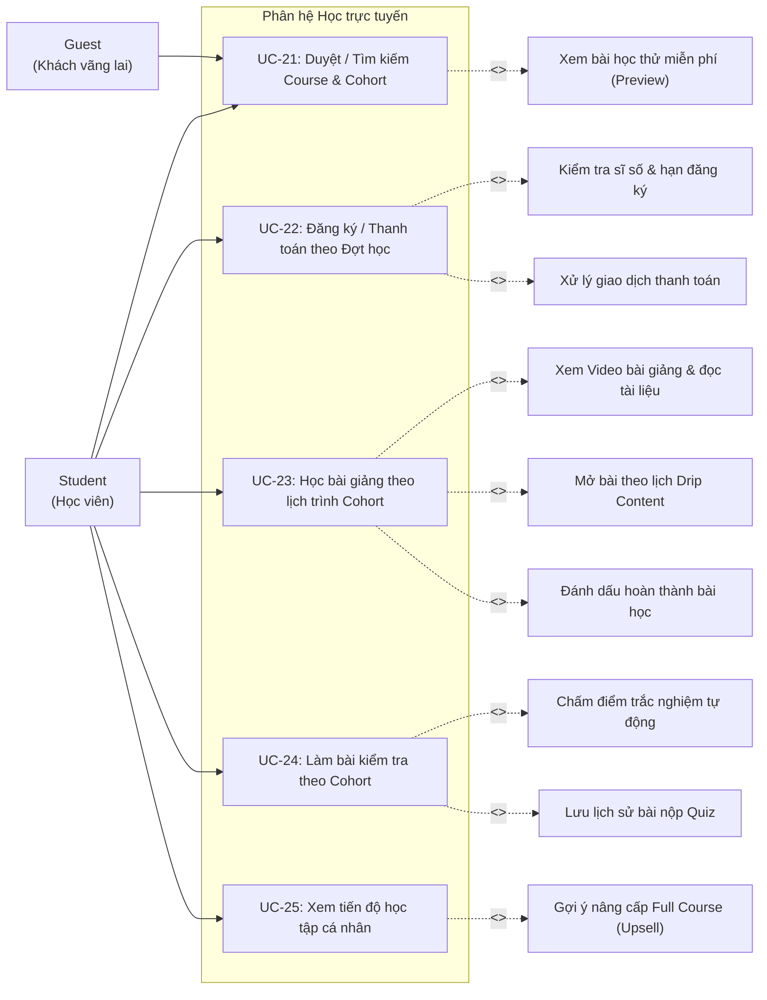

# UC05 – Học trực tuyến (Student Learning Module)

## 1. Luồng Nghiệp vụ Đăng ký & Học tập theo Đợt

---

## 2. Use Case Diagram

---

## 3. Chi tiết Use Case

### UC-21: Duyệt / Tìm kiếm Course & Cohort

| Thuộc tính | Chi tiết mô tả |
|------------|----------------|
| **Mã Use Case** | UC-21 |
| **Tên Use Case** | Duyệt / Tìm kiếm Course & Cohort (Browse & Search Courses) |
| **Actor chính** | Guest, Student |
| **Mô tả** | Người dùng xem danh mục, tìm kiếm và xem chi tiết Khóa học lớn (Course) cùng các Đợt học (Cohorts) đang mở tuyển sinh. |
| **Luồng sự kiện chính** | 1. Người dùng truy cập trang chủ `/home` hoặc `/courses`. 2. Hệ thống hiển thị danh sách các khóa học đã được xuất bản (`status = PUBLISHED`). 3. Người dùng lọc theo: Danh mục (Category), Cấp độ (Beginner/Intermediate/Advanced), Từ khóa tìm kiếm. 4. Người dùng bấm vào một khóa học để xem trang chi tiết `/courses/{slug}`: &nbsp;&nbsp;&nbsp;&nbsp;- Tiêu đề, headline, mô tả chi tiết, giảng viên phụ trách, mục tiêu và yêu cầu. &nbsp;&nbsp;&nbsp;&nbsp;- Khung giáo trình chuẩn (các chương Section và bài học Lesson). &nbsp;&nbsp;&nbsp;&nbsp;- Học thử các bài học có gắn cờ `is_free_preview`. &nbsp;&nbsp;&nbsp;&nbsp;- **Danh sách các Đợt học (Cohorts) đang tuyển sinh**: Tên đợt, mã lớp, học phí, sĩ số hiện tại/tối đa, thời gian khai giảng. |
| **Hậu điều kiện** | Người dùng nắm rõ thông tin và sẵn sàng chọn Đợt học phù hợp để đăng ký. |

---

### UC-22: Đăng ký / Thanh toán theo Đợt học

| Thuộc tính | Chi tiết mô tả |
|------------|----------------|
| **Mã Use Case** | UC-22 |
| **Tên Use Case** | Đăng ký / Thanh toán theo Đợt học (Cohort Enrollment) |
| **Actor chính** | Student |
| **Tiền điều kiện** | Học viên đã đăng nhập tài khoản. |
| **Mô tả** | Học viên chọn một Đợt học (Cohort) cụ thể thuộc khóa học và thực hiện ghi danh / thanh toán học phí. |
| **Luồng sự kiện chính** | 1. Tại trang chi tiết khóa học `/courses/{slug}`, học viên chọn Đợt học (Cohort) muốn tham gia. 2. Học viên bấm nút **"Ghi danh"** ứng với Đợt học đó. 3. Nếu đợt học có phí (`price > 0`), hệ thống chuyển hướng đến `/checkout/{cohortId}`. 4. Học viên chọn phương thức thanh toán và hoàn tất giao dịch. 5. Cổng thanh toán xác nhận giao dịch thành công. 6. Hệ thống thêm học viên vào bảng `cohort_members` với vai trò `STUDENT`. 7. Tự động tăng biến `current_enrolled` của Đợt học đó lên 1. 8. Chuyển hướng học viên đến không gian học tập của lớp `/courses/{slug}/learn`. |
| **Luồng ngoại lệ** | - Lớp học đã đủ sĩ số tối đa (`current_enrolled >= max_capacity`) -> Báo lớp đã đủ số lượng học viên. - Đã qua thời hạn đăng ký (`enrollment_end`) -> Thông báo đợt tuyển sinh đã đóng. |
| **Hậu điều kiện** | Học viên được cấp quyền truy cập đầy đủ vào các bài học và phòng chat của Đợt học đó. |

---

### UC-23: Học bài giảng theo lịch trình Cohort

| Thuộc tính | Chi tiết mô tả |
|------------|----------------|
| **Mã Use Case** | UC-23 |
| **Tên Use Case** | Học bài giảng theo lịch trình Cohort (Study Lessons within Cohort Schedule) |
| **Actor chính** | Student |
| **Actor hỗ trợ** | TA, Instructor |
| **Tiền điều kiện** | Học viên đã ghi danh thành công vào Đợt học (`cohort_members`). |
| **Mô tả** | Học viên truy cập không gian học tập của khóa học, xem bài giảng mở theo lịch trình điều phối của Đợt học. |
| **Luồng sự kiện chính** | 1. Học viên vào trang học tập `/courses/{slug}/learn`. 2. Sidebar hiển thị toàn bộ giáo trình các chương (Section) và bài học (Lesson). 3. Với mỗi bài học, hệ thống kiểm tra trạng thái mở khóa theo bảng `cohort_schedules` của Đợt học: &nbsp;&nbsp;&nbsp;&nbsp;- Nếu bài học đã đến thời gian mở (`unlock_at <= hiện tại`): Học viên bấm vào để xem Video bài giảng hoặc đọc tài liệu. &nbsp;&nbsp;&nbsp;&nbsp;- Nếu bài học chưa đến thời gian mở: Hiển thị icon khóa kèm thông báo thời điểm sẽ mở. 4. Khi học xong, học viên nhấn **"Đánh dấu hoàn thành"**. 5. Hệ thống lưu tiến độ học tập và tự động chuyển tiếp sang bài kế tiếp nếu đã mở. |
| **Hậu điều kiện** | Tiến độ học tập của học viên được cập nhật chính xác. |

---

### UC-24: Làm bài kiểm tra theo Cohort

| Thuộc tính | Chi tiết mô tả |
|------------|----------------|
| **Mã Use Case** | UC-24 |
| **Tên Use Case** | Làm bài kiểm tra theo Cohort (Take Cohort Assessment Quiz) |
| **Actor chính** | Student |
| **Tiền điều kiện** | Học viên đã ghi danh vào Đợt học và bài kiểm tra đã đến thời điểm mở khóa. |
| **Mô tả** | Học viên làm bài kiểm tra trắc nghiệm theo thời gian quy định và nộp bài trước hạn chót (`deadline_at`) của Đợt học. |
| **Luồng sự kiện chính** | 1. Học viên mở bài kiểm tra Quiz trong cây bài học. 2. Màn hình tóm tắt thông tin: Số lượng câu hỏi, thời gian làm bài (`duration_minutes`), điểm đạt (`passing_score`), hạn nộp bài (`deadline_at`). 3. Học viên nhấn **"Bắt đầu làm bài"**. 4. Hệ thống hiển thị câu hỏi và đồng hồ đếm ngược. 5. Học viên chọn đáp án và nhấn **"Nộp bài"**. 6. Hệ thống tự động chấm điểm và lưu kết quả vào bảng `quiz_submissions`. 7. Hiển thị điểm số theo cấu hình của Đợt học (`show_score_type`: xem ngay hoặc sau deadline). |
| **Luồng ngoại lệ** | - Quá hạn nộp bài (`deadline_at`) -> Hệ thống từ chối nhận bài làm mới. |
| **Hậu điều kiện** | Điểm số được ghi nhận vào hồ sơ học tập của học viên trong Đợt học. |

---

### UC-25: Xem tiến độ học tập cá nhân

| Thuộc tính | Chi tiết mô tả |
|------------|----------------|
| **Mã Use Case** | UC-25 |
| **Tên Use Case** | Xem tiến độ học tập cá nhân (View Learning Progress) |
| **Actor chính** | Student |
| **Mô tả** | Học viên theo dõi tổng quan các khóa học và đợt học mình đã tham gia tại `/courses/my-courses`. Đối với các khóa học mới mua một số module lẻ, hệ thống hiển thị khối gợi ý Upsell nâng cấp trọn gói khóa học với chính sách chỉ bù phần tiền chênh lệch. |
| **Luồng sự kiện chính** | 1. Học viên truy cập trang cá nhân hoặc menu **"Khóa học của tôi"** (`/courses/my-courses`). 2. Hệ thống phân chia hiển thị theo 2 tab: "Trọn gói Khóa học" và "Module & Học phần lẻ" kèm thời gian học, tiến độ hoàn thành bài giảng. 3. Học viên nhấn **"Tiếp tục học"** để chuyển thẳng vào bài học đang dở dang. |
| **Luồng mở rộng (Extension - Upsell)** | **2a. Gợi ý nâng cấp Full Course (Upsell):** - Tại tab "Module & Học phần lẻ", với mỗi khóa học mẹ mà học viên mới sở hữu một số module, hệ thống hiển thị khối thẻ ưu đãi Nâng cấp trọn gói (Upgrade Upsell). - Hệ thống tự động tính toán số tiền chênh lệch: `Số tiền nâng cấp = Giá Full Course - Tổng số tiền đã thanh toán cho các Cohort trước đó`. - Hiển thị trực quan: Số module đã sở hữu / Tổng số module, số tiền đã khấu trừ 100%, số tiền bù thêm ưu đãi và số tiền tiết kiệm được so với mua lẻ. - Học viên bấm **"Nâng cấp trọn gói ngay"** -> Hệ thống chuyển hướng sang trang thanh toán `/checkout/course/{slug}` áp dụng đúng mức giá chênh lệch. - Sau khi xác nhận thanh toán thành công, toàn bộ các module còn lại của khóa học được tự động kích hoạt vào tài khoản học viên và chuyển khóa học sang tab "Trọn gói Khóa học". |
| **Hậu điều kiện** | Học viên nắm bắt tiến độ học tập của bản thân và có thể dễ dàng nâng cấp lên trọn gói khóa học tiết kiệm chi phí. |
