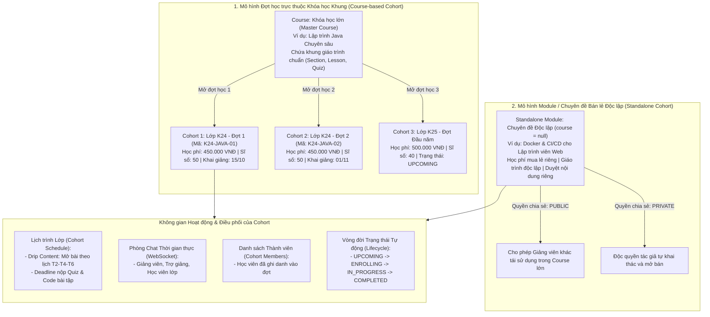
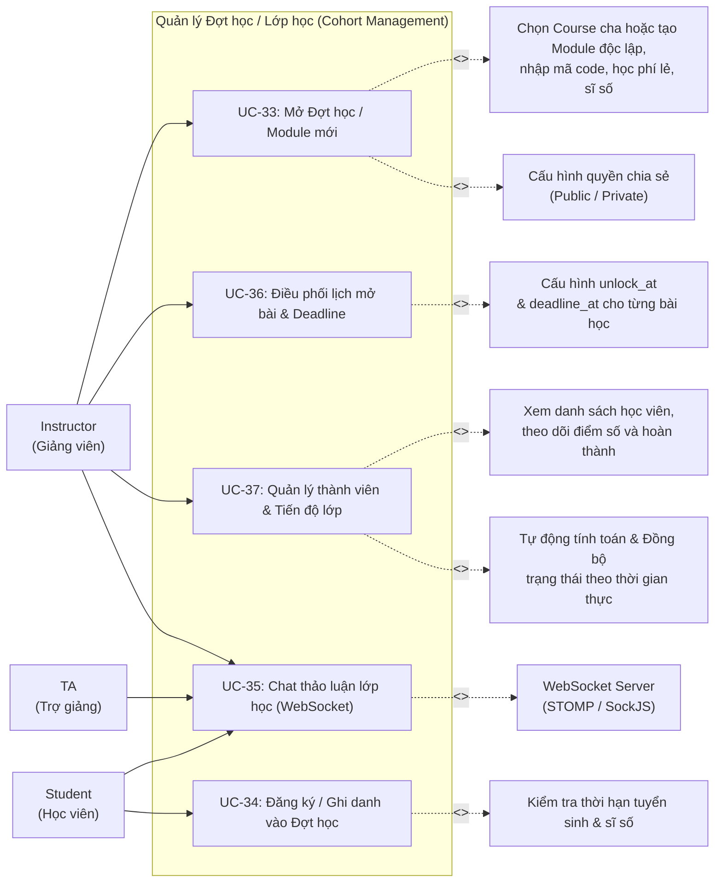
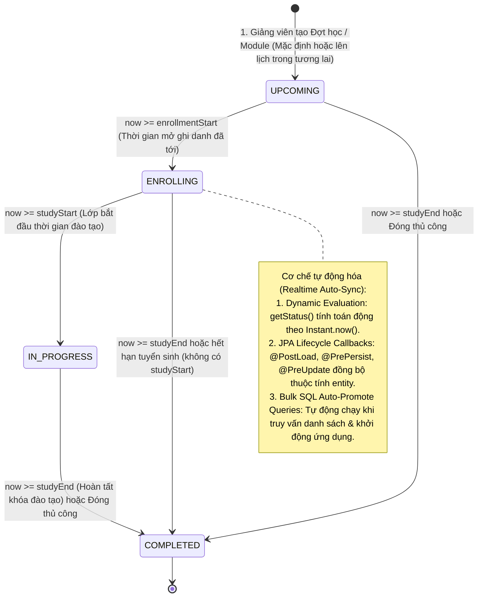
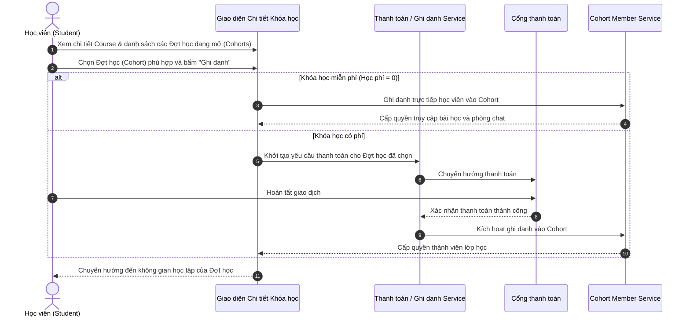

# UC08 – Quản lý Đợt học / Lớp học (Cohort Management)

## 1. Mô hình Quan hệ Khóa học (Course) - Module / Đợt học (Cohort)

---

## 2. Use Case Diagram

---

## 3. Sơ đồ Vòng đời Trạng thái Đợt học / Module (Cohort Lifecycle State Machine Diagram)

---

## 4. Luồng Nghiệp vụ Đăng ký Đợt học (Cohort Enrollment Flow)

---

## 5. Chi tiết Use Case

### UC-33: Mở Đợt học / Module mới

| Thuộc tính | Chi tiết mô tả |
|------------|----------------|
| **Mã Use Case** | UC-33 |
| **Tên Use Case** | Mở Đợt học / Module mới (Open New Cohort / Standalone Module) |
| **Actor chính** | Instructor |
| **Tiền điều kiện** | Giảng viên đã đăng nhập tài khoản có quyền `INSTRUCTOR`. |
| **Mô tả** | Giảng viên tạo thêm một đợt tuyển sinh / lớp học cụ thể (Cohort) trực thuộc Course cha hoặc tạo **Module chuyên đề bán lẻ độc lập** (`course_id = null`), định nghĩa học phí mua lẻ, sĩ số, lịch mở tuyển sinh & đào tạo, và quyền chia sẻ (`visibility`). |
| **Luồng sự kiện chính** | 1. Giảng viên vào `/instructor/cohorts/create`. 2. Chọn Khóa học cha (`course_id`) từ danh sách Course do mình phụ trách, HOẶC chọn **"Bán lẻ độc lập (Không thuộc khóa học)"**. 3. Điền các trường thông tin của đợt học / module: &nbsp;&nbsp;&nbsp;&nbsp;- Mã lớp (`code` - hệ thống tự động sinh theo mẫu `{PREFIX}-YYYY-XX` nếu để trống). &nbsp;&nbsp;&nbsp;&nbsp;- Tên đợt / module (`name`). &nbsp;&nbsp;&nbsp;&nbsp;- Học phí mua lẻ (`price` - VNĐ, nhập 0 nếu miễn phí). &nbsp;&nbsp;&nbsp;&nbsp;- Thời gian mở và đóng đăng ký (`enrollment_start`, `enrollment_end`). &nbsp;&nbsp;&nbsp;&nbsp;- Thời gian bắt đầu và kết thúc học (`study_start`, `study_end`). &nbsp;&nbsp;&nbsp;&nbsp;- Sĩ số tối đa (`max_capacity`, mặc định 50). &nbsp;&nbsp;&nbsp;&nbsp;- Quyền chia sẻ (`visibility`: `PUBLIC` - cho phép giảng viên khác dùng trong khóa học của họ, hoặc `PRIVATE` - độc quyền tác giả). 4. Nhấn **"Lưu đợt học / module"**. 5. Hệ thống kiểm tra tính hợp lệ dữ liệu (ngày mở < đóng đăng ký, ngày bắt đầu < kết thúc học, mã duy nhất). 6. Hệ thống tự động tính toán trạng thái khởi tạo (`calculateDynamicStatus()`), lưu bản ghi vào bảng `cohorts`. Nếu là module độc lập, gán `moderation_status = DRAFT` để chuẩn bị gửi duyệt. |
| **Ràng buộc nghiệp vụ** | 1. **Tính hợp lệ thời gian**: Ngày mở đăng ký phải trước ngày đóng đăng ký; ngày bắt đầu học phải trước ngày kết thúc. 2. **Phân định quyền chỉnh sửa (`canEdit`)**: Chỉ Giảng viên tạo Module (`cohort.createdBy`), Giảng viên sở hữu Course cha hoặc Quản trị viên (`ADMIN`) mới có quyền bật công tắc Chế độ chỉnh sửa (`moodleEditModeToggle`), sửa thông tin hoặc cấu trúc Module. Kiểm duyệt viên (Moderator) khi xem xét module chỉ có quyền thẩm định Read-Only (`hasAccessRole = true, canEdit = false`), hệ thống ẩn toàn bộ công tắc edit mode và chặn các API chỉnh sửa module. |
| **Luồng ngoại lệ** | - Trùng mã code hoặc khoảng thời gian không hợp lệ -> Hệ thống báo lỗi tương ứng. |
| **Hậu điều kiện** | Đợt học / module mới sẵn sàng để biên soạn giáo trình, điều phối lịch học hoặc gửi duyệt bán lẻ. |

---

### UC-34: Đăng ký / Ghi danh vào Đợt học

| Thuộc tính | Chi tiết mô tả |
|------------|----------------|
| **Mã Use Case** | UC-34 |
| **Tên Use Case** | Đăng ký / Ghi danh vào Đợt học (Cohort Enrollment) |
| **Actor chính** | Student |
| **Tiền điều kiện** | Học viên đã đăng nhập tài khoản UTELearn. |
| **Mô tả** | Học viên chọn một Đợt học hoặc Module bán lẻ đang mở tuyển sinh để đăng ký tham gia. |
| **Luồng sự kiện chính** | 1. Học viên vào trang chi tiết khóa học `/courses/{slug}` hoặc chi tiết module `/cohorts/{id}`. 2. Giao diện hiển thị danh sách các Đợt học đang mở ghi danh (`ENROLLING`) hoặc sắp mở (`UPCOMING`). 3. Học viên chọn Đợt học mong muốn và bấm **"Ghi danh"**. 4. Nếu lớp có học phí > 0, hệ thống chuyển hướng đến trang thanh toán `/checkout/{cohortId}`. 5. Học viên hoàn tất thanh toán (hoặc ghi danh trực tiếp nếu miễn phí). 6. Hệ thống thêm học viên vào bảng `cohort_members` với vai trò `STUDENT`. 7. Tự động tăng số lượng `current_enrolled` của Cohort đó lên 1. |
| **Luồng ngoại lệ** | - Lớp đã đủ sĩ số tối đa (`current_enrolled >= max_capacity`) -> Thông báo lớp đã đủ số lượng học viên. - Đã qua thời hạn đăng ký (`enrollment_end`) -> Thông báo đợt đăng ký đã kết thúc. |
| **Hậu điều kiện** | Học viên sở hữu quyền truy cập nội dung bài học, nộp bài tập và vào phòng chat của Đợt học đã chọn. |

---

### UC-35: Chat thảo luận lớp học (WebSocket)

| Thuộc tính | Chi tiết mô tả |
|------------|----------------|
| **Mã Use Case** | UC-35 |
| **Tên Use Case** | Chat thảo luận lớp học thời gian thực (Real-time Cohort Chat) |
| **Actor chính** | Student, Teaching Assistant (TA), Instructor |
| **Tiền điều kiện** | Người dùng đã được ghi danh trong Cohort (`cohort_members`). |
| **Mô tả** | Không gian trao đổi học tập thời gian thực giữa Giảng viên, Trợ giảng và Học viên trong phạm vi từng Đợt học. |
| **Luồng sự kiện chính** | 1. Học viên truy cập không gian học tập của Đợt học. 2. Mở panel chat thảo luận của lớp. 3. Ứng dụng client thiết lập kết nối WebSocket (STOMP qua SockJS) đến server endpoint `/ws`. 4. Client đăng ký lắng nghe (subscribe) topic của lớp: `/topic/cohort/{cohortId}`. 5. Người dùng gửi tin nhắn đến `/app/cohort/{cohortId}/send`. 6. Server xác thực quyền thành viên trong Cohort, lưu tin nhắn vào bảng `cohort_messages`, và broadcast tin nhắn đến tất cả thành viên trong phòng. 7. Giao diện người dùng hiển thị tin nhắn ngay lập tức kèm họ tên, avatar và vai trò của người gửi. |
| **Luồng ngoại lệ** | - Người dùng chưa ghi danh trong Cohort -> Server từ chối kết nối (403 Forbidden). |
| **Dữ liệu lưu trữ** | `cohort_messages`: id, cohort_id, sender_id, message, message_type, created_at. |

---

### UC-36: Điều phối lịch mở bài & Deadline (Drip Content & Late Submission Policy)

| Thuộc tính | Chi tiết mô tả |
|------------|----------------|
| **Mã Use Case** | UC-36 |
| **Tên Use Case** | Điều phối lịch mở bài & Deadline (Cohort Schedule & Unlock Management) |
| **Actor chính** | Instructor |
| **Actor xem** | Student, TA |
| **Mô tả** | Thiết lập thời gian mở từng bài học (Lesson Unlock - Drip Content), thời hạn chót nộp bài (Deadline) hiển thị thân thiện, chế độ công bố điểm số và kiểm soát chính sách nộp trễ trong Đợt học. |
| **Luồng sự kiện chính** | 1. Giảng viên truy cập `/instructor/cohorts/{id}/schedule`. 2. Hệ thống liệt kê toàn bộ các bài học (Lesson), bài kiểm tra (Quiz) và bài tập tự luận (Assignment) kế thừa từ Course cha hoặc giáo trình module. 3. Với từng bài học, Giảng viên cấu hình: &nbsp;&nbsp;&nbsp;&nbsp;- Thời điểm mở bài (`unlock_at` - học viên chỉ xem được sau thời điểm này). &nbsp;&nbsp;&nbsp;&nbsp;- Hạn nộp bài (`deadline_at` - áp dụng cho Quiz, Assignment và Coding Problem). &nbsp;&nbsp;&nbsp;&nbsp;- Chế độ xem điểm (`show_score_type`: IMMEDIATELY, AFTER_DEADLINE, MANUAL). &nbsp;&nbsp;&nbsp;&nbsp;- Cho phép xem lại đáp án (`allow_review_answers`). 4. **Cơ chế hiển thị & Kiểm soát nộp trễ (Deadline Tracking & Late Policy)**: &nbsp;&nbsp;&nbsp;&nbsp;- Hệ thống tự động chuyển đổi ngày giờ hạn chót sang định dạng trực quan thân thiện (`deadlineAtDisplay`). &nbsp;&nbsp;&nbsp;&nbsp;- Tự động đánh giá trạng thái quá hạn theo thời gian thực (`isDeadlinePassed` / `isPastDeadline`). &nbsp;&nbsp;&nbsp;&nbsp;- Kết hợp cấu hình `allowLateSubmission`: Cho phép nộp trễ (gắn cờ `isLate = true` và badge đỏ cảnh báo) hoặc khóa hoàn toàn quyền nộp bài khi đã quá deadline. 5. Nhấn **"Lưu lịch học"**. 6. Dữ liệu được lưu vào bảng `cohort_schedules`. Học viên truy cập lớp học sẽ thấy lịch trình mở bài và hạn nộp rõ ràng. |
| **Hậu điều kiện** | Bài giảng và bài kiểm tra tự động khóa/mở và kiểm soát hạn chót nộp bài theo đúng lịch trình của Đợt học. |

---

### UC-37: Quản lý thành viên, Chấm bài tập Assignment & Tiến độ lớp học

| Thuộc tính | Chi tiết mô tả |
|------------|----------------|
| **Mã Use Case** | UC-37 |
| **Tên Use Case** | Quản lý thành viên, Chấm bài tập Assignment & Tiến độ lớp (Cohort Members & Assignment Grading) |
| **Actor chính** | Instructor |
| **Mô tả** | Giảng viên theo dõi danh sách học viên đã ghi danh vào Đợt học, kiểm tra tiến độ học bài, quản lý vòng đời lớp học tự động (Auto-Sync Lifecycle), và trực tiếp chấm điểm, nhận xét các bài tập tự luận (Assignment) do học viên nộp theo từng Cohort. |
| **Luồng sự kiện chính** | 1. **Đồng bộ Vòng đời Đợt học tự động**: &nbsp;&nbsp;&nbsp;&nbsp;- Giảng viên mở `/instructor/cohorts`, hệ thống tự động kích hoạt đồng bộ hàng loạt trạng thái (`syncCohortStatuses()`): các đợt đến giờ mở ghi danh chuyển thành `ENROLLING`, đến giờ học thành `IN_PROGRESS`, và hết giờ thành `COMPLETED`. &nbsp;&nbsp;&nbsp;&nbsp;- Giảng viên xem thống kê sĩ số hiện tại (`current_enrolled / max_capacity`) và danh sách thành viên trong bảng `cohort_members`. 2. **Quản lý & Chấm điểm bài tập tự luận Assignment theo Cohort**: &nbsp;&nbsp;&nbsp;&nbsp;- Tại giáo trình Cohort (`module-curriculum.html` hoặc `curriculum.html`), Giảng viên bấm nút **"Xem bài nộp"** tại bài tập Assignment tương ứng. &nbsp;&nbsp;&nbsp;&nbsp;- Hệ thống hiển thị bảng thống kê bài nộp của học viên trong lớp qua API `/api/instructor/assignments/{assignmentId}/submissions?cohortId={cohortId}`. &nbsp;&nbsp;&nbsp;&nbsp;- Hiển thị số lượng: Tổng bài nộp, số bài "Chờ chấm" (màu cam sẫm nổi bật `#b45309`), và các bài nộp trễ (badge đỏ `bg-danger text-white`). &nbsp;&nbsp;&nbsp;&nbsp;- Bấm tải file bài làm của học viên về máy để thẩm định. &nbsp;&nbsp;&nbsp;&nbsp;- Bấm **"Chấm điểm"** (hoặc "Nhận xét" nếu không tính điểm) -> Mở modal chấm điểm: Nhập số điểm đạt được (trên thang `maxScore`), ghi lời nhận xét đánh giá (`feedback`), tick chọn Đạt yêu cầu (`isPassed`). &nbsp;&nbsp;&nbsp;&nbsp;- Bấm "Lưu kết quả chấm" -> Hệ thống cập nhật bảng `assignment_submissions`, chuyển trạng thái thành `GRADED`. Nếu bài nộp đạt điểm sàn, tự động cập nhật hoàn thành bài học vào `lesson_completions` cho học viên. 3. Giảng viên có thể chủ động đánh dấu hoàn thành/đóng đợt học (`COMPLETED`) bất kỳ lúc nào nếu kết thúc khóa học sớm. |
| **Hậu điều kiện** | Kết quả chấm điểm và nhận xét được lưu trữ đầy đủ, học viên nhận được phản hồi ngay lập tức trên không gian học tập. |

