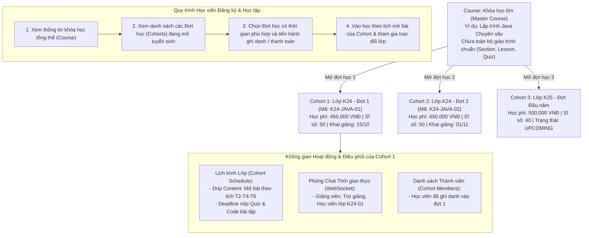
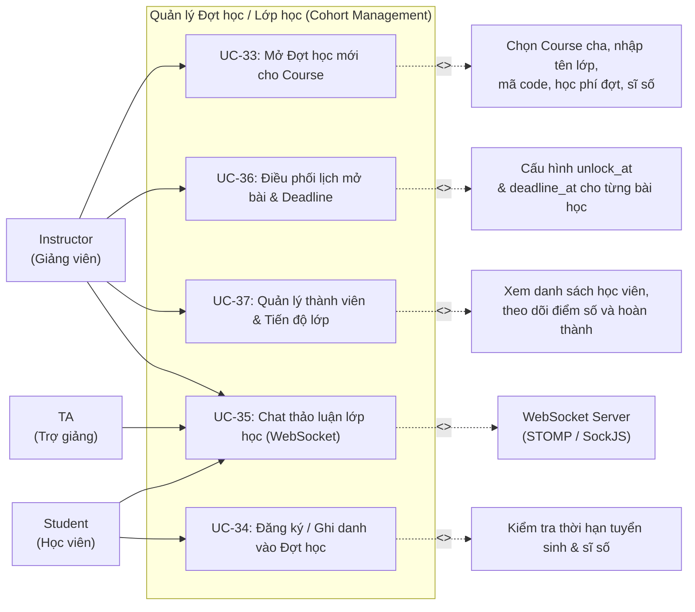
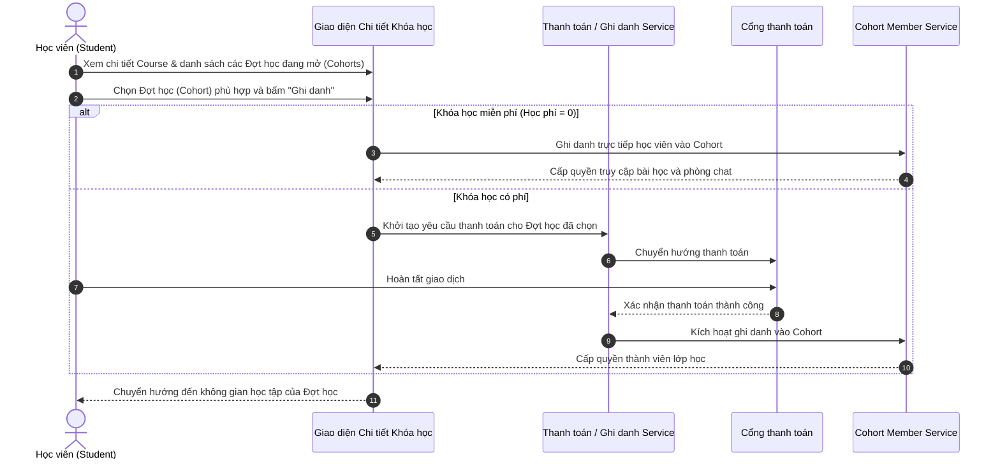

# UC08 – Quản lý Đợt học / Lớp học (Cohort Management)

## 1. Mô hình Quan hệ Khóa học (Course) - Đợt học (Cohort)

---

## 2. Use Case Diagram

---

## 3. Luồng Nghiệp vụ Đăng ký Đợt học (Cohort Enrollment Flow)

---

## 4. Chi tiết Use Case

### UC-33: Mở Đợt học mới cho Course

| Thuộc tính | Chi tiết mô tả |
|------------|----------------|
| **Mã Use Case** | UC-33 |
| **Tên Use Case** | Mở Đợt học mới cho Course (Open New Cohort for Course) |
| **Actor chính** | Instructor |
| **Tiền điều kiện** | Khóa học cha (Course) đã được tạo và thuộc sở hữu của Giảng viên. |
| **Mô tả** | Giảng viên tạo thêm một đợt tuyển sinh / lớp học cụ thể (Cohort) trực thuộc Course cha, định nghĩa học phí của đợt, sĩ số và thời gian đào tạo. |
| **Luồng sự kiện chính** | 1. Giảng viên vào `/instructor/cohorts/create`. 2. Chọn Khóa học cha (`course_id`) từ danh sách các Course do mình phụ trách. 3. Điền các trường thông tin của đợt học: &nbsp;&nbsp;&nbsp;&nbsp;- Mã lớp (`code` - duy nhất trong hệ thống, VD: `K24-JAVA-01`). &nbsp;&nbsp;&nbsp;&nbsp;- Tên lớp (`name` - VD: `Lớp Java Chuyên sâu K24 - Đợt 1`). &nbsp;&nbsp;&nbsp;&nbsp;- Học phí của đợt (`price` - VNĐ). &nbsp;&nbsp;&nbsp;&nbsp;- Thời gian mở và đóng đăng ký (`enrollment_start`, `enrollment_end`). &nbsp;&nbsp;&nbsp;&nbsp;- Thời gian bắt đầu và kết thúc học (`study_start`, `study_end`). &nbsp;&nbsp;&nbsp;&nbsp;- Sĩ số tối đa (`max_capacity`, mặc định 50). 4. Nhấn **"Lưu lớp học"**. 5. Hệ thống kiểm tra tính hợp lệ dữ liệu (ngày mở < đóng đăng ký, ngày bắt đầu < kết thúc học, mã duy nhất). 6. Hệ thống tạo bản ghi mới trong bảng `cohorts` liên kết với `course_id`. |
| **Luồng ngoại lệ** | - Trùng mã code hoặc khoảng thời gian không hợp lệ -> Hệ thống báo lỗi tương ứng. |
| **Hậu điều kiện** | Đợt học mới sẵn sàng để tiếp nhận học viên và điều phối lịch học. |

---

### UC-34: Đăng ký / Ghi danh vào Đợt học

| Thuộc tính | Chi tiết mô tả |
|------------|----------------|
| **Mã Use Case** | UC-34 |
| **Tên Use Case** | Đăng ký / Ghi danh vào Đợt học (Cohort Enrollment) |
| **Actor chính** | Student |
| **Tiền điều kiện** | Học viên đã đăng nhập tài khoản UTELearn. |
| **Mô tả** | Học viên chọn một Đợt học cụ thể của khóa học đang mở tuyển sinh để đăng ký tham gia. |
| **Luồng sự kiện chính** | 1. Học viên vào trang chi tiết khóa học `/courses/{slug}`. 2. Giao diện hiển thị danh sách các Đợt học (Cohorts) đang mở hoặc sắp mở của khóa học đó. 3. Học viên chọn Đợt học mong muốn và bấm **"Ghi danh"**. 4. Nếu lớp có học phí > 0, hệ thống chuyển hướng đến trang thanh toán `/checkout/{cohortId}`. 5. Học viên hoàn tất thanh toán (hoặc ghi danh trực tiếp nếu miễn phí). 6. Hệ thống thêm học viên vào bảng `cohort_members` với vai trò `STUDENT`. 7. Tự động tăng số lượng `current_enrolled` của Cohort đó lên 1. |
| **Luồng ngoại lệ** | - Lớp đã đủ sĩ số tối đa (`current_enrolled >= max_capacity`) -> Thông báo lớp đã đủ số lượng học viên. - Đã qua thời hạn đăng ký (`enrollment_end`) -> Thông báo đợt đăng ký đã kết thúc. |
| **Hậu điều kiện** | Học viên sở hữu quyền truy cập nội dung bài học, nộp bài tập và vào phòng chat của Đợt học đã chọn. |

---

### UC-35: Chat thảo luận lớp học (WebSocket)

| Thuộc tính | Chi tiết mô tả |
|------------|----------------|
| **Mã Use Case** | UC-35 |
| **Tên Use Case** | Chat thảo luận lớp học thời gian thực (Real-time Cohort Chat) |
| **Actor chính** | Student, Teaching Assistant (TA), Instructor |
| **Tiền điều kiện** | Người dùng đã được ghi danh trong Cohort (`cohort_members`). |
| **Mô tả** | Không gian trao đổi học tập thời gian thực giữa Giảng viên, Trợ giảng và Học viên trong phạm vi từng Đợt học. |
| **Luồng sự kiện chính** | 1. Học viên truy cập không gian học tập của Đợt học. 2. Mở panel chat thảo luận của lớp. 3. Ứng dụng client thiết lập kết nối WebSocket (STOMP qua SockJS) đến server endpoint `/ws`. 4. Client đăng ký lắng nghe (subscribe) topic của lớp: `/topic/cohort/{cohortId}`. 5. Người dùng gửi tin nhắn đến `/app/cohort/{cohortId}/send`. 6. Server xác thực quyền thành viên trong Cohort, lưu tin nhắn vào bảng `cohort_messages`, và broadcast tin nhắn đến tất cả thành viên trong phòng. 7. Giao diện người dùng hiển thị tin nhắn ngay lập tức kèm họ tên, avatar và vai trò của người gửi. |
| **Luồng ngoại lệ** | - Người dùng chưa ghi danh trong Cohort -> Server từ chối kết nối (403 Forbidden). |
| **Dữ liệu lưu trữ** | `cohort_messages`: id, cohort_id, sender_id, message, message_type, created_at. |

---

### UC-36: Điều phối lịch mở bài & Deadline (Drip Content)

| Thuộc tính | Chi tiết mô tả |
|------------|----------------|
| **Mã Use Case** | UC-36 |
| **Tên Use Case** | Điều phối lịch mở bài & Deadline (Cohort Schedule & Unlock Management) |
| **Actor chính** | Instructor |
| **Actor xem** | Student, TA |
| **Mô tả** | Thiết lập thời gian mở từng bài học (Lesson Unlock - Drip Content), thời hạn chót nộp bài (Deadline), và chế độ công bố điểm số trong Đợt học. |
| **Luồng sự kiện chính** | 1. Giảng viên truy cập `/instructor/cohorts/{id}/schedule`. 2. Hệ thống liệt kê toàn bộ các bài học (Lesson) và bài kiểm tra (Quiz) kế thừa từ Course cha. 3. Với từng bài học, Giảng viên cấu hình: &nbsp;&nbsp;&nbsp;&nbsp;- Thời điểm mở bài (`unlock_at` - học viên chỉ xem được sau thời điểm này). &nbsp;&nbsp;&nbsp;&nbsp;- Hạn nộp bài (`deadline_at` - áp dụng cho quiz và bài tập lập trình). &nbsp;&nbsp;&nbsp;&nbsp;- Chế độ xem điểm (`show_score_type`: IMMEDIATELY, AFTER_DEADLINE, MANUAL). &nbsp;&nbsp;&nbsp;&nbsp;- Cho phép xem lại đáp án (`allow_review_answers`). 4. Nhấn **"Lưu lịch học"**. 5. Dữ liệu được lưu vào bảng `cohort_schedules`. Học viên truy cập lớp học sẽ thấy lịch trình mở bài rõ ràng. |
| **Hậu điều kiện** | Bài giảng và bài kiểm tra tự động khóa/mở theo đúng lịch trình của Đợt học. |

---

### UC-37: Quản lý thành viên & Tiến độ lớp học

| Thuộc tính | Chi tiết mô tả |
|------------|----------------|
| **Mã Use Case** | UC-37 |
| **Tên Use Case** | Quản lý thành viên & Tiến độ lớp (Cohort Members & Progress Management) |
| **Actor chính** | Instructor |
| **Mô tả** | Giảng viên theo dõi danh sách học viên đã ghi danh vào Đợt học, kiểm tra tiến độ học bài và kết quả bài thi. |
| **Luồng sự kiện chính** | 1. Giảng viên mở mục quản lý Đợt học `/instructor/cohorts`. 2. Xem thống kê sĩ số hiện tại (`current_enrolled / max_capacity`) và trạng thái lớp (`UPCOMING`, `ENROLLING`, `IN_PROGRESS`, `COMPLETED`). 3. Xem danh sách thành viên trong bảng `cohort_members` (họ tên, email, ngày ghi danh, kết quả đạt/chưa đạt). 4. Cập nhật trạng thái đợt học khi kết thúc khóa đào tạo. |
| **Hậu điều kiện** | Giảng viên nắm bắt toàn diện tiến độ của lớp học theo từng đợt. |
